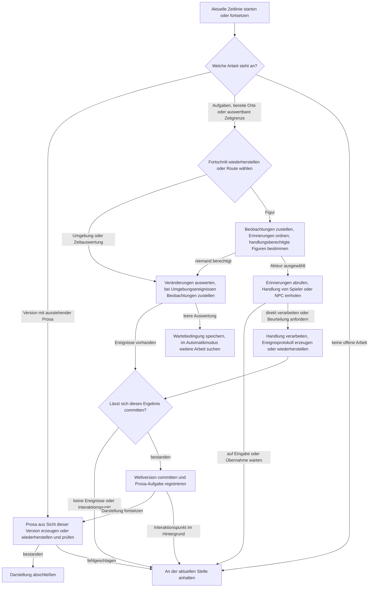

<div align="center">

  
  <h1>JO-ENWSim</h1>

  <h2>Keine Handlung inszenieren, nur Kausalität wirken lassen.<br/>Die Welt festlegen, den Auftakt setzen und sie sich selbst entfalten lassen.</h2>

  <p>
    <a href="https://jo-beacon.github.io/JO-ENWSim/">Website</a> ·
    <a href="https://github.com/JO-Beacon/JO-ENWSim">GitHub</a> ·
    <a href="https://github.com/JO-Beacon/JO-ENWSim/releases/latest">Neueste Version</a>
  </p>

  <p>
    <a href="./README_en_US.md">English</a> ·
    <a href="./README.md">简体中文</a> ·
    <a href="README.zh-TW.md">繁體中文</a> ·
    <a href="README.ja.md">日本語</a> ·
    <a href="README.ko.md">한국어</a> ·
    <b>Deutsch</b> ·
    <a href="README.es.md">Español</a> ·
    <a href="README.fr.md">Français</a> ·
    <a href="README.pt-BR.md">Português</a> ·
    <a href="README.sv.md">Svenska</a>
  </p>

</div>

JO-ENWSim ist ein emergenter narrativer Weltsimulator, eine kausale Sandbox mit mehreren Agenten. Der Spieler steuert eine Figur, die übrigen Figuren werden von KI geführt. Es gibt kein Skript; die Welt entfaltet sich durch Kausalität.

[English](./README_en_US.md) · [Apache License 2.0](./LICENSE)


Das Bild oben zeigt den Arbeitsbereich: In der linken Spalte stehen die Welten, in der Mitte die **Sequenz-Leinwand** (jede Spalte ist ein Ort, jeder Schritt ein Ereignis, die spaltenübergreifenden Linien bedeuten „an einen anderen Ort gewechselt“), oben im rechten Bereich das stets sichtbare **Zugablaufdiagramm** (eingeklappt nur eine Zeile; ein Klick klappt den gesamten Ablauf auf), darunter die Details der aktuellen Welt – Weltbild, Auftakt, Figuren; Erinnerungen und Modelle befinden sich im Dialog „Bearbeiten“ am unteren Rand.

## Status

**Es lässt sich inzwischen wirklich ein Zug ausführen – aber spielbar ist es noch nicht.**

Was bereits funktioniert:

- Welten anlegen, Weltbild und Auftakt schreiben, Figuren hinzufügen, Modellanbieter konfigurieren (OpenAI / DeepSeek / Xiaomi MiMo / SiliconFlow …)
- **Echte Zugausführung**: Pausieren nach einem Schritt und Fortsetzen werden unterstützt; Umgebungs- und Figurenrouten behandeln Ereignisse, Erinnerungen, Handlungen, Beurteilungen und Prosa getrennt, KI-Aufrufe laufen getrennt von Programmvalidierung und Schreibvorgängen
- **Handlungseingabefeld.** Nach dem Senden des vom Spieler erklärten Handlungstexts startet oder setzt der Arbeitsbereich den Zug fort. Erst wenn die gesteuerte Figur handeln oder einen Konflikt beantworten muss, verarbeitet der Parser diesen Text und unterscheidet Aktion, Sprechtext und Inneres. Die Sendetaste ist standardmäßig `Ctrl+Enter`, Enter fügt einen Zeilenumbruch ein; beides lässt sich unter Einstellungen → Tastenkürzel ändern.
- Welten und Züge liegen in einer lokalen SQLite-Datenbank und sind nach einem Neustart noch da
- **Suche**: Das Globus-Symbol ganz rechts in der Symbolleiste ist der einzige Einstieg; es öffnet ein aufklappendes Menü: die unabhängige Suchquelle dieser Welt wählen (keine Suche / Tavily / DeepSeek) oder „Einmal suchen …“ wählen, um im Suchpanel eine manuelle Suche auszuführen; das Ergebnis geht an das nächste Umgebungsupdate. Die modellintegrierte Suche gehört zu den Fähigkeiten des Modellanbieters, wird in den Anbietereinstellungen aktiviert und nur an das Umgebungsupdate angehängt. Das Suchprotokoll ist bereits in der Datenbank gespeichert, die Obergrenze unabhängiger Suchen pro Zug lässt sich unter Einstellungen → Suchdienst anpassen (Standard 10, Bereich 1–100); die Wiederherstellung von Material über einen Neustart hinweg fehlt noch
- Erinnerungen manuell bearbeiten, Tastenkürzel ändern
- Das rechte Panel lässt sich aufklappen, um den Zugablauf und die aktuelle Phase zu sehen.
- **Die Symbolleiste über dem Handlungseingabefeld**: Bilder einfügen, Dateien einfügen (Text / PDF / Bilder), OCR-Bild (integriertes PP-OCR, Windows / Android) und Foto aufnehmen (nur Fotos, kein Video) sind alle angebunden; leere Textseiten in gescannten PDFs werden automatisch gerendert und durch die integrierte OCR geschickt
- **TTS**: System-TTS und Anbieter-TTS sind angebunden (Anbieter-TTS unterstützt derzeit OpenAI / Xiaomi MiMo); Melo / Kokoro werden wie andere sherpa-onnx-Modelle (AISHELL-3, LJSpeech usw.) bei Bedarf unter Einstellungen → TTS-Dienst → Modelle → Herunterladbare Modelle heruntergeladen und nicht mit dem Installationspaket ausgeliefert; Melo / Kokoro lassen sich direkt synthetisieren, die übrigen herunterladbaren Modelle sind noch nicht an die Synthese-Engine angebunden. Der Text lässt sich Zug für Zug vorlesen; Stimmen, Vorschau und Cache befinden sich ebenfalls dort
- **Erinnerungsagent**: ordnet die Erinnerungen einer Figur nach encode / reinforce / compress / reinterpret / archive; vor dem Handeln kann er aktiv suchen, die eigenen abrufbaren archivierten Originaltexte lesen und auswählen, mit Budgetgrenzen und Wiederaufnahme nach Unterbrechung

Noch nicht angebunden:

- Dauerhaftes Protokoll, Fehleraufzeichnungen und Wiederherstellung nach einem Neustart für Suchabsichten von Figuren

Was in der Oberfläche noch nicht angebunden ist, wird an Ort und Stelle markiert; es wird nichts vorgespielt.

## Grundprinzipien

- **Informationsisolation** – jede Figur hat eigene Daten. Wenn eine Figur gesteuert wird, sieht sie nur, was diese Figur weiß, und nichts von den anderen.
- **Die Spielerfigur wird nicht gesondert behandelt** – Spielerfigur und NPC sind gleich aufgebaut; der einzige Unterschied ist, dass der Spieler ihr Verhalten bestimmt und die KI sie nicht ersetzen darf.
- **Semantik nicht auf Zahlen reduzieren** – Zustand, Beziehungen, Wahrnehmung und Handeln einer Figur werden in Text ausgedrückt, nicht zu Sympathiewerten, Attributwerten oder Wahrscheinlichkeiten gepresst; wo Semantik zu beurteilen ist, übernimmt die KI.

## So funktioniert es

Ein normaler Figurenzug wählt zuerst einen Akteur aus. Versuchen andere Figuren, dieselbe Sache zu erlangen oder dasselbe Ergebnis zu beeinflussen, kann die Engine ihre Versuche im selben Zug abwickeln. Ein Umgebungszug treibt die Ereignisse der Welt selbst voran.

| Agent | Aufgabe |
| --- | --- |
| **Gott** | Treibt die Welt voran, wählt die teilnehmenden Figuren aus und bestimmt den nächsten Akteur |
| **Figurenwahrnehmung** | Was diese Figur in diesem Moment wahrnimmt |
| **Figurenhandlung** | Wie diese Figur handelt; NPCs werden von der KI gesteuert, die Spielerfigur vom Spieler |
| **Figurenerinnerung** | Ordnet die Erinnerungen dieser Figur und ruft vor dem Handeln ab, woran sie sich gerade erinnert |

### Zeitlinien und Verzweigungen

Über den zweidimensionalen Verzweigungsbaum lässt sich das Ende jeder Zeitlinie öffnen; an einem Verzweigungszug kann man über „Folgeverlauf anzeigen“ auch direkt abzweigen. Nur bereits committete Züge können einen Zweig eröffnen. „Diesen Zug neu durchspielen“ startet vom letzten abgeschlossenen Zug eine neue Linie und rechnet sie sofort durch; der erste Zug lässt sich daher nicht neu durchspielen.

Beim Abzweigen läuft die ursprüngliche Linie nach der Einstellung „Hintergrundausführung“ weiter (Einfrieren, Einzelschritt, Einzelzug, bis zum Interaktionspunkt/Automatisch; Standard: Einzelschritt). Nach einem Neustart ist alles eingefroren und läuft erst nach manuellem Fortsetzen weiter. Während auf Spielereingaben gewartet wird, startet dieselbe Linie keinen neuen Zug; andere bereits gestartete Züge können zu Ende laufen und halten dann an.

Unter Einstellungen → Engine → Automatische Ausführung lässt sich die Obergrenze der Modellparallelität einstellen, Standard 1. Bei der Fortsetzungsart „Bis zum Interaktionspunkt“ und einer Obergrenze von mindestens 2 können zwei lokale Züge gleichzeitig laufen, sofern sie sich nachweislich nicht beeinflussen; Züge mit gemeinsamem Zustand werden nacheinander ausgeführt.

Die „Fortsetzungsart“ in der oberen Leiste betrifft nur das manuelle Senden: Einzelschritt führt nur eine Phase aus, Einzelzug einen ganzen Zug. Welten ohne Spieler haben keinen Interaktionspunkt, auf den sie warten könnten; dort zeigt diese Stufe „Automatisch“ an.

Der Spieler kann gespeicherte KI-Schritte bearbeiten. Der Speicherstand bewahrt den Modelltext und die Überarbeitung des Spielers getrennt. Nach Abschluss des laufenden Schritts verarbeitet der Arbeitsbereich die Überarbeitung anhand der Prüfpunkte der Aufgabe. Werden Schritte in einem bereits committeten Zug bearbeitet, bleiben die ursprüngliche Weltversion und die Folgezüge erhalten; eine Bearbeitung des Prosatexts kann zudem die dargestellten Inhalte ändern. [Überarbeitungsspeicher](lib/data/world_timeline.dart#L400)

### Ablauf eines Zugs

Die folgende Grafik folgt der Senden-Schaltfläche des Arbeitsbereichs sowie den Fortsetzungsarten „Einzelschritt“ und „Bis zum Interaktionspunkt“ und zeigt eine Zeitlinie mit Weltversionen – wohin ein einzelner Vorgang führen kann.



Modelle lassen sich schichtweise zuweisen: **der eigene Schritt einer Figur → Figurenstandard → Weltschritt → Weltstandard → globaler Schritt → globaler Standard**.

Das rechte Panel der Anwendung zeigt den Fortschritt mit weniger Knoten an; so teilen sich etwa die Beurteilung vor Ort und die Figurenwahrnehmung dieselbe Hervorhebung. [Zuordnung im rechten Panel](lib/ui/turn_flow.dart#L21)

## Bauen und Ausführen

Benötigt [Flutter](https://flutter.dev) (stable). Für das Windows-Paket werden zusätzlich PowerShell 7 und Inno Setup 6/7 benötigt, für das Android-Paket das Android SDK.

```sh
flutter pub get

# Starten
flutter run -d windows

# Windows-Release und Android-Split-APKs bauen
scripts/build.ps1            # mit -SkipAndroid lässt sich Android überspringen
```

TTS-Modelle sind nicht Teil des Installationspakets; sie werden zur Laufzeit unter Einstellungen → TTS-Dienst → Modelle → Herunterladbare Modelle heruntergeladen.

Artefakte:

- Windows: `build/windows/x64/runner/Release/joenws.exe`
- Installationsprogramm (Inno Setup) und Android-Split-APKs (arm / arm64 / x64): `dist/`

## Lizenz

[Apache License 2.0](./LICENSE) · Copyright 2026 JO-Beacon

Komponenten Dritter und die vollständigen Lizenztexte stehen in [NOTICE](./NOTICE); in der App auch unter **Einstellungen → Info → Open-Source-Lizenzen anzeigen**.
