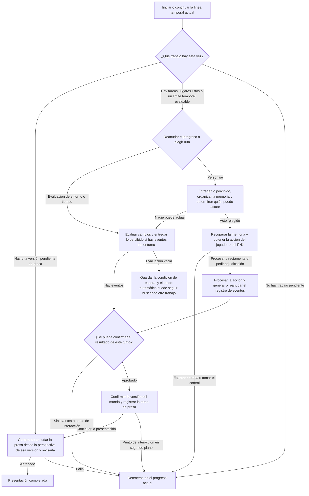

<div align="center">

  
  <h1>JO-ENWSim</h1>

  <h2>No compone tramas: solo simula la causalidad.<br/>Define el mundo, introduce el comienzo y deja que se despliegue por sí solo.</h2>

  <p>
    <a href="https://jo-beacon.github.io/JO-ENWSim/">Sitio web</a> ·
    <a href="https://github.com/JO-Beacon/JO-ENWSim">GitHub</a> ·
    <a href="https://github.com/JO-Beacon/JO-ENWSim/releases/latest">Última versión</a>
  </p>

  <p>
    <a href="./README_en_US.md">English</a> ·
    <a href="./README.md">简体中文</a> ·
    <a href="README.zh-TW.md">繁體中文</a> ·
    <a href="README.ja.md">日本語</a> ·
    <a href="README.ko.md">한국어</a> ·
    <a href="README.de.md">Deutsch</a> ·
    <b>Español</b> ·
    <a href="README.fr.md">Français</a> ·
    <a href="README.pt-BR.md">Português</a> ·
    <a href="README.sv.md">Svenska</a>
  </p>

</div>

JO-ENWSim es un simulador de mundo narrativo emergente: un sandbox causal gestionado por varios agentes. El jugador controla a un personaje y la IA maneja a los demás. No hay guion: el mundo se despliega por causalidad.

[English](./README_en_US.md) · [Apache License 2.0](./LICENSE)


La imagen muestra el espacio de trabajo: en la columna izquierda está la lista de mundos; en el centro, el **lienzo de secuencias** (cada columna es un lugar, cada paso un evento y las líneas que cruzan las columnas son “cambios de lugar”); en la parte superior de la columna derecha, el **diagrama de flujo del turno**, siempre presente (ocupa una sola línea cuando está contraído; un clic lo despliega entero), y debajo, los detalles del mundo actual: ambientación, comienzo y personajes. La memoria y los modelos están en el diálogo “Editar” (编辑) de la parte inferior.

## Estado actual

**Ya puede ejecutar turnos de verdad, pero todavía no es un juego jugable.**

Lo que ya funciona:

- Crear mundos, escribir la ambientación y el comienzo, añadir personajes y configurar proveedores de modelos (OpenAI / DeepSeek / Xiaomi MiMo / SiliconFlow…)
- **Ejecución real de turnos**: permite pausar tras un paso y continuar; las líneas de entorno y de personaje gestionan por separado eventos, memoria, acciones, adjudicación y prosa, y las llamadas a la IA se ejecutan aparte de la validación y las escrituras del programa
- **Entrada de acciones.** Al enviar el texto original de la acción declarada por el jugador, el espacio de trabajo inicia o continúa el turno. Cuando le toca actuar al personaje controlado o responder a una disputa, el analizador procesa ese texto y distingue acción, diálogo y pensamiento. La tecla de envío es `Ctrl+Enter` por defecto; Intro inserta un salto de línea. Ambas se reasignan en Ajustes → Atajos de teclado.
- Los mundos y los turnos se guardan en una base SQLite local y siguen ahí tras cerrar y volver a abrir
- **Búsqueda**: el globo del extremo derecho de la barra de herramientas es el único punto de entrada; al pulsarlo se despliega un menú hacia arriba para elegir la fuente de búsqueda independiente de este mundo (sin búsqueda / Tavily / DeepSeek), o “Buscar una vez…” para abrir el panel de búsqueda y hacer una búsqueda manual; el resultado pasa a la siguiente actualización del entorno. La búsqueda integrada del modelo es una capacidad del proveedor y se activa en su configuración; solo se asocia a la actualización del entorno. El registro de búsquedas ya se guarda en la base de datos y el límite de búsquedas independientes por turno se ajusta en Ajustes → Servicio de búsqueda: 10 por defecto, rango 1–100. Recuperar el material tras reiniciar aún no está hecho
- Editar la memoria a mano y cambiar los atajos
- La columna derecha permite desplegar el flujo del turno y ver la fase actual.
- **La barra de herramientas sobre la entrada de acciones**: insertar imágenes, insertar archivos (texto / PDF / imágenes), OCR de imágenes (PP-OCR integrado, Windows / Android) y tomar una foto (solo foto, sin vídeo) ya están conectados; las páginas sin texto de los PDF escaneados se renderizan solas y pasan por el OCR integrado
- **TTS**: el TTS del sistema y el TTS de la API ya están conectados (el de la API admite por ahora OpenAI / Xiaomi MiMo); Melo / Kokoro, igual que los modelos sherpa-onnx como AISHELL-3 o LJSpeech, se descargan bajo demanda en Ajustes → Servicio TTS → Modelos → Modelos descargables y no vienen con el instalador; Melo / Kokoro pueden sintetizar directamente, pero el resto de modelos descargados aún no está conectado al motor de síntesis. Se puede leer la prosa turno a turno, y las voces, la escucha previa y la caché también están ahí
- **Agente de memoria**: organiza la memoria de cada personaje con encode / reinforce / compress / reinterpret / archive; antes de actuar puede buscar, leer y elegir los textos originales de su propio archivo recuperable, con límites de presupuesto y recuperación tras interrupciones

Lo que todavía no está conectado:

- Registro persistente de las intenciones de búsqueda de los personajes, registro de fallos y recuperación tras reiniciar

Todo lo que aún no está conectado en la interfaz se marca en el momento; no se finge lo contrario.

## Principios fundamentales

- **Aislamiento de la información**: cada personaje tiene sus propios datos. Al controlar a un personaje solo se ve lo que ese personaje sabe, nunca lo de los demás.
- **El personaje del jugador no recibe un trato especial**: es estructuralmente idéntico a un PNJ; la única diferencia es que sus actos los decide el jugador, y la IA no puede decidirlos en su lugar.
- **No reducir la semántica a números**: el estado, las relaciones, la percepción y las acciones de un personaje se expresan en texto, sin comprimirlos en puntos de afinidad, valores de atributos ni probabilidades; donde hay que juzgar semántica, decide la IA.

## Cómo funciona

Un turno normal de personaje empieza eligiendo a un actor. Si los intentos de otros personajes compiten por la misma cosa o afectan al mismo resultado, el motor puede resolver los intentos de varios en el mismo turno. El turno de entorno hace avanzar los eventos del propio mundo.

| Agente | Función |
| --- | --- |
| **Dios** | Hace avanzar el mundo, selecciona los personajes que participan y decide quién actúa después |
| **Percepción del personaje** | Lo que este personaje percibe en este momento |
| **Acción del personaje** | Cómo actúa este personaje; a los PNJ los maneja la IA y al personaje del jugador, el jugador |
| **Memoria del personaje** | Organiza la memoria de este personaje y, antes de actuar, recupera lo que recordaría en este momento |

### Líneas temporales y ramas

El árbol de ramas bidimensional permite abrir el final de cualquier línea temporal o ramificar en el punto de bifurcación con “Ver continuación”. Solo los turnos confirmados pueden originar una rama. “Rehacer este turno” abre una línea nueva desde el turno completado anterior y simula de inmediato, así que el primer turno no se puede rehacer.

Al ramificar, la línea original corre según el ajuste de “simulación en segundo plano” (congelar, un paso, un turno, hasta el punto de interacción / automático; por defecto, un paso). Tras reiniciar, todas las líneas quedan congeladas y solo se reanudan al continuar a mano. Mientras espera la entrada del jugador, la misma línea no abre nuevos turnos, y los demás turnos ya iniciados pueden terminar de resolverse antes de detenerse.

En Ajustes → Motor → Simulación automática se ajusta el límite de concurrencia de modelos, 1 por defecto. Con el modo “hasta el punto de interacción” y un límite de al menos 2, se pueden simular a la vez dos turnos locales de los que se ha confirmado que no se afectan entre sí; los turnos que comparten estado se ejecutan en orden.

El “modo de avance” de la barra superior solo afecta al envío manual: un paso avanza una sola fase y un turno ejecuta un turno completo. Un mundo sin jugador no tiene punto de interacción que esperar, así que esa opción se muestra como “automático”.

El jugador puede editar los pasos de IA ya guardados. El guardado conserva por separado el texto original del modelo y la revisión del jugador. Cuando termina el paso en ejecución, el espacio de trabajo aplica las revisiones según los puntos de control de la tarea. Editar un paso de un turno confirmado conserva la versión original del mundo y los turnos posteriores, y editar la prosa también puede cambiar lo que se muestra. [Almacenamiento de revisiones](lib/data/world_timeline.dart#L400)

### El flujo de un turno

Este diagrama sigue el botón de envío del espacio de trabajo y los modos “un paso” y “hasta el punto de interacción” a lo largo de una línea temporal con versiones del mundo, para mostrar hasta dónde puede llegar una operación.



Los modelos se pueden asignar por capas: **el paso propio del personaje → el valor predeterminado del personaje → el paso del mundo → el valor predeterminado del mundo → el paso global → el valor predeterminado global**.

La columna derecha del programa muestra el progreso con menos nodos: por ejemplo, la adjudicación en directo y la percepción del personaje comparten un mismo resaltado. [Correspondencia de la columna derecha](lib/ui/turn_flow.dart#L21)

## Compilación y ejecución

Requiere [Flutter](https://flutter.dev) (stable). Para empaquetar en Windows también hacen falta PowerShell 7 e Inno Setup 6/7; para empaquetar en Android, el SDK de Android.

```sh
flutter pub get

# Arrancar
flutter run -d windows

# Release de Windows y APK de Android por ABI
scripts/build.ps1            # añade -SkipAndroid para omitir Android
```

Los modelos TTS no vienen con el instalador: se descargan en tiempo de ejecución en Ajustes → Servicio TTS → Modelos → Modelos descargables.

Artefactos:

- Windows: `build/windows/x64/runner/Release/joenws.exe`
- Instalador (Inno Setup) y APK de Android por ABI (arm / arm64 / x64): `dist/`

## Licencia

[Apache License 2.0](./LICENSE) · Copyright 2026 JO-Beacon

Los componentes de terceros y el texto completo de las licencias están en [NOTICE](./NOTICE); también se pueden consultar dentro de la aplicación en **Ajustes → Acerca de → Ver licencias de código abierto**.
