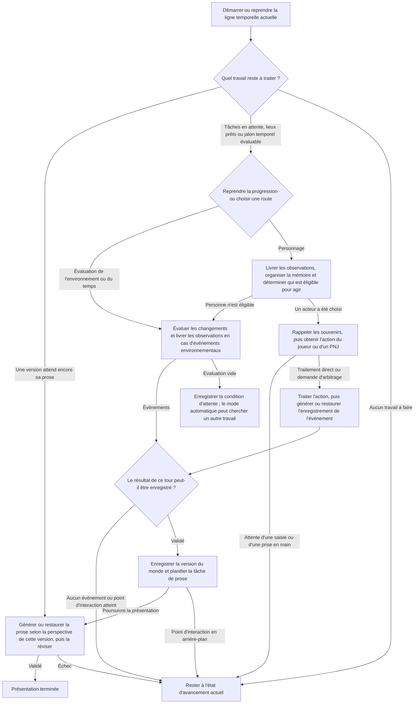

<div align="center">

  
  <h1>JO-ENWSim</h1>

  <h2>Pas d'intrigue à écrire, seulement de la causalité à dérouler.<br/>Posez un monde, déposez une ouverture, laissez-le se dérouler de lui-même.</h2>

  <p>
    <a href="https://jo-beacon.github.io/JO-ENWSim/">Site officiel</a> ·
    <a href="https://github.com/JO-Beacon/JO-ENWSim">GitHub</a> ·
    <a href="https://github.com/JO-Beacon/JO-ENWSim/releases/latest">Dernière version</a>
  </p>

  <p>
    <a href="./README_en_US.md">English</a> ·
    <a href="./README.md">简体中文</a> ·
    <a href="README.zh-TW.md">繁體中文</a> ·
    <a href="README.ja.md">日本語</a> ·
    <a href="README.ko.md">한국어</a> ·
    <a href="README.de.md">Deutsch</a> ·
    <a href="README.es.md">Español</a> ·
    <b>Français</b> ·
    <a href="README.pt-BR.md">Português</a> ·
    <a href="README.sv.md">Svenska</a>
  </p>

</div>

JO-ENWSim est un simulateur de monde narratif émergent — un bac à sable causal animé par plusieurs agents. Le joueur contrôle un personnage et l'IA pilote les autres. Il n'y a pas de scénario ; le monde se déroule de lui-même par causalité.

[English](./README_en_US.md) · [Apache License 2.0](./LICENSE)


La capture ci-dessus montre l'espace de travail : la colonne de gauche liste les mondes ; au centre se trouve le **canevas des séquences** (chaque colonne est un lieu, chaque étape est un événement, et les lignes qui traversent les colonnes signifient « changer de lieu ») ; en haut du panneau de droite se trouve le **diagramme du déroulement des tours**, toujours présent (replié sur une seule ligne — cliquez dessus pour déplier le flux complet), et en dessous, les détails du monde courant — cadre, ouverture et personnages ; les souvenirs et les modèles se trouvent dans la boîte de dialogue « Modifier », en bas.

## État actuel

**Il sait désormais réellement simuler des tours, mais on ne peut pas encore vraiment y jouer.**

Ce qui fonctionne déjà :

- Création de mondes, rédaction du cadre et de l'ouverture, ajout de personnages, configuration des fournisseurs de modèles (OpenAI / DeepSeek / Xiaomi MiMo / SiliconFlow …)
- **Simulation réelle des tours** : mise en pause après une étape et reprise prises en charge ; la ligne environnement et la ligne personnage traitent chacune les événements, la mémoire, les actions, l'arbitrage et la prose, les appels IA étant exécutés séparément de la validation par le programme et des écritures
- **Le champ de saisie d'action.** Après l'envoi du texte brut de l'action déclarée par le joueur, l'espace de travail démarre ou reprend le tour. Ce n'est que lorsque le personnage contrôlé doit agir ou répondre à une contestation que l'analyseur traite ce texte, en distinguant action, réplique et pensée intérieure. La touche d'envoi par défaut est `Ctrl+Enter` et Entrée insère un saut de ligne ; les deux peuvent être modifiés dans Paramètres → Raccourcis.
- Les mondes et les tours sont stockés dans une base SQLite locale et survivent à un redémarrage
- **Recherche** : le globe à l'extrême droite de la barre d'outils est le seul point d'entrée ; un clic ouvre un menu qui se déploie vers le haut : choisissez la source de recherche indépendante de ce monde (Aucune recherche / Tavily / DeepSeek), ou « Rechercher une fois… » pour ouvrir le panneau de recherche et lancer une recherche manuelle ; le résultat est transmis à la prochaine mise à jour de l'environnement. La recherche intégrée au modèle est une capacité du fournisseur, activée dans les paramètres du fournisseur et attachée uniquement à la mise à jour de l'environnement. Le registre de recherche est persisté, et la limite de recherches indépendantes par tour se règle dans Paramètres → Service de recherche (10 par défaut, plage 1–100) ; la restauration des matériaux après redémarrage n'est pas encore faite
- Modification manuelle des souvenirs et réaffectation des raccourcis
- Le panneau de droite peut déplier le déroulement des tours et afficher la phase en cours.
- **La barre d'outils au-dessus du champ de saisie d'action** : l'insertion d'images, l'insertion de fichiers (texte / PDF / images), l'OCR sur images (PP-OCR intégré, Windows / Android) et la prise de photos (photos uniquement, pas de vidéo) sont toutes câblées ; les pages sans texte des PDF numérisés sont rendues automatiquement, puis passées à l'OCR intégré
- **TTS** : la TTS système et la TTS via API sont câblées (la TTS via API prend actuellement en charge OpenAI / Xiaomi MiMo) ; Melo / Kokoro, comme les modèles sherpa-onnx tels qu'AISHELL-3 et LJSpeech, se téléchargent à la demande dans Paramètres → Service TTS → Modèles → Modèles téléchargeables et ne sont pas préinstallés avec le programme d'installation ; Melo / Kokoro peuvent synthétiser directement, tandis que les autres modèles téléchargés ne sont pas encore reliés au moteur de synthèse. La prose peut être lue à voix haute tour par tour, et les voix, les aperçus et le cache se trouvent également ici
- **Agent Mémoire** : organise la mémoire de chaque personnage avec encode / reinforce / compress / reinterpret / archive ; avant d'agir, il peut rechercher activement, lire et sélectionner ses propres textes archivés rappelables, avec des limites de budget et une reprise après interruption

Pas encore connecté :

- Registre persistant, journal des échecs et reprise après redémarrage pour les intentions de recherche des personnages

Partout où l'interface n'est pas encore connectée, elle le signale sur place au lieu de faire semblant.

## Principes fondamentaux

- **Isolation de l'information** — chaque personnage dispose de ses propres données. Lorsqu'un personnage est piloté, il ne voit que ce que ce personnage sait, jamais autre chose.
- **Aucun traitement particulier pour le personnage joueur** — le personnage joueur est structurellement identique à un PNJ ; la seule différence est que ses actions sont décidées par le joueur, et l'IA ne doit pas les décider à sa place.
- **Ne pas réduire la sémantique à des nombres** — l'état, les relations, la perception et les actions d'un personnage sont exprimés en texte, sans être compressés en scores d'affinité, valeurs de statistiques ou scores de probabilité ; partout où la sémantique doit être jugée, c'est l'IA qui décide.

## Fonctionnement

Un tour de personnage ordinaire choisit d'abord un acteur. Si les tentatives d'autres personnages portent sur la même chose ou influencent le même résultat, le moteur peut résoudre plusieurs tentatives dans le même tour. Les tours d'environnement font avancer les événements propres au monde.

| Agent | Rôle |
| --- | --- |
| **Dieu** | Fait avancer le monde, sélectionne les personnages qui y participent et décide qui agit ensuite |
| **Perception du personnage** | Ce que ce personnage perçoit à cet instant |
| **Action du personnage** | Comment ce personnage agit ; les PNJ sont pilotés par l'IA, le personnage joueur par le joueur |
| **Mémoire du personnage** | Organise la mémoire de ce personnage et, avant d'agir, rappelle ce dont il se souviendrait à cet instant |

### Lignes temporelles et branches

Ouvrez la fin de n'importe quelle ligne temporelle depuis l'arbre de branches en 2D, ou créez une branche sur place à un tour de bifurcation via « Voir la suite ». Seuls les tours validés peuvent donner lieu à une branche. « Rejouer ce tour » ouvre une nouvelle ligne depuis le dernier tour terminé et la simule immédiatement ; le premier tour ne peut donc pas être rejoué.

Lors d'une bifurcation, la ligne d'origine continue selon le réglage de « simulation en arrière-plan » (gel, une étape, un tour, jusqu'à un point d'interaction / automatique ; une étape par défaut). Après un redémarrage, toutes les lignes sont gelées et ne reprennent que sur reprise manuelle. Tant qu'une ligne attend une saisie du joueur, elle ne démarre aucun nouveau tour ; les autres tours déjà en cours peuvent se terminer avant l'arrêt.

Dans Paramètres → Moteur → Simulation automatique, on peut régler la limite de concurrence des modèles, 1 par défaut. Avec le mode d'avancement « Jusqu'à un point d'interaction » et une limite d'au moins 2, deux tours locaux confirmés comme indépendants peuvent être simulés en même temps ; les tours qui partagent un état s'exécutent l'un après l'autre.

Le « mode d'avancement » de la barre supérieure ne régit que le tour lancé en cliquant sur Envoyer : « Une étape » n'exécute qu'une seule phase, « Un tour » exécute un tour complet. Un monde sans joueur n'a aucun point d'interaction à attendre ; cette option y apparaît comme « Automatique ».

Le joueur peut modifier les étapes IA enregistrées. La sauvegarde conserve séparément le texte original du modèle et la révision du joueur. Une fois l'étape en cours d'exécution terminée, l'espace de travail applique la révision selon le point de contrôle de la tâche. Modifier une étape d'un tour validé préserve la version d'origine du monde et les tours suivants ; modifier la prose peut aussi changer ce qui est présenté. [Stockage des révisions](lib/data/world_timeline.dart#L400)

### Déroulement d'un tour

Le diagramme ci-dessous suit le bouton Envoyer de l'espace de travail et les modes d'avancement « Une étape » et « Jusqu'à un point d'interaction », en traçant une ligne temporelle dotée d'une version du monde pour montrer où une seule opération peut mener.



Les modèles peuvent être assignés par couches : **étape propre au personnage → valeur par défaut du personnage → étape du monde → valeur par défaut du monde → étape globale → valeur par défaut globale**.

Le panneau de droite de l'application affiche la progression de l'exécution avec moins de nœuds ; par exemple, l'arbitrage sur place et la perception du personnage partagent une même position mise en évidence. [Correspondance du panneau de droite](lib/ui/turn_flow.dart#L21)

## Compilation et exécution

Nécessite [Flutter](https://flutter.dev) (stable). La compilation Windows nécessite aussi PowerShell 7 et Inno Setup 6/7 ; la compilation Android nécessite le SDK Android.

```sh
flutter pub get

# lancer l'application
flutter run -d windows

# générer la version Windows et les APK Android séparés
scripts/build.ps1            # ajouter -SkipAndroid pour ignorer la compilation Android
```

Les modèles TTS ne sont pas inclus dans l'installation ; téléchargez-les au moment de l'utilisation dans Paramètres → Service TTS → Modèles → Modèles téléchargeables.

Artefacts :

- Windows : `build/windows/x64/runner/Release/joenws.exe`
- Programme d'installation (Inno Setup) et APK Android séparés par ABI (arm / arm64 / x64) : `dist/`

## Licence

[Apache License 2.0](./LICENSE) · Copyright 2026 JO-Beacon

Les composants tiers et les textes complets de leurs licences figurent dans [NOTICE](./NOTICE) ; ils sont aussi consultables dans l'application sous **Paramètres → À propos → Voir les licences open source**.
