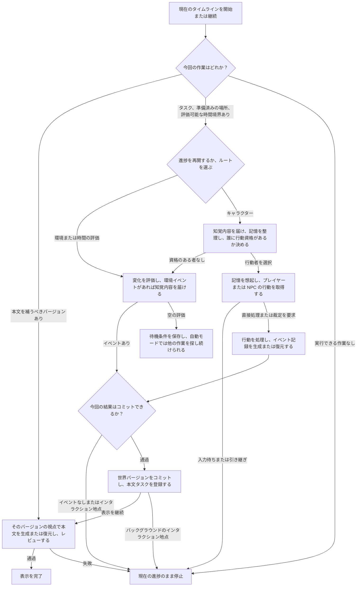

<div align="center">

  
  <h1>JO-ENWSim</h1>

  <h2>筋書きを編まず、因果だけを推し進める。<br/>世界を設定し、冒頭を置き、あとは自ら展開させよう。</h2>

  <p>
    <a href="https://jo-beacon.github.io/JO-ENWSim/">公式サイト</a> ·
    <a href="https://github.com/JO-Beacon/JO-ENWSim">GitHub</a> ·
    <a href="https://github.com/JO-Beacon/JO-ENWSim/releases/latest">最新リリース</a>
  </p>

  <p>
    <a href="./README_en_US.md">English</a> ·
    <a href="./README.md">简体中文</a> ·
    <a href="README.zh-TW.md">繁體中文</a> ·
    <b>日本語</b> ·
    <a href="README.ko.md">한국어</a> ·
    <a href="README.de.md">Deutsch</a> ·
    <a href="README.es.md">Español</a> ·
    <a href="README.fr.md">Français</a> ·
    <a href="README.pt-BR.md">Português</a> ·
    <a href="README.sv.md">Svenska</a>
  </p>

</div>

JO-ENWSim は創発的ナラティブ世界シミュレーターであり、複数のエージェントによる因果のサンドボックスだ。プレイヤーは 1 人のキャラクターを操作し、残りのキャラクターはそれぞれ AI が動かす。脚本はなく、世界は因果に沿って自ら展開する。

[English](./README_en_US.md) · [Apache License 2.0](./LICENSE)


上の図はワークスペースだ。左のレールは世界の一覧、中央は**シーケンスキャンバス**（各列が 1 つの場所、各ステップが 1 つのイベント、列をまたぐ線は「場所の移動」を表す）、右パネルの上部は常設の**ターンフロー図**（折りたたむと 1 行だけ表示され、クリックすると全体を展開できる）、その下は現在の世界の詳細——世界観、冒頭、キャラクター——だ。記憶とモデルは下部の「編集」ダイアログにある。

## 現在の状態

**実際にターンを回せるようになったが、まだ「遊べる」段階ではない。**

現在できること：

- 世界の作成、世界観と冒頭の記述、キャラクターの追加、モデルプロバイダーの設定（OpenAI / DeepSeek / Xiaomi MiMo / SiliconFlow …）
- **実際のターン実行**：ステップ単位の一時停止と再開に対応。環境ルートとキャラクタールートがそれぞれイベント、記憶、行動、裁定、本文を処理し、AI の呼び出しと、プログラムによる検証・書き込みは別々に実行される
- **行動入力欄。** プレイヤーが宣言した行動の原文を送信すると、ワークスペースがターンを開始または再開する。操作キャラクターが行動する番、または争いに応答する番になったときだけ、パーサーがその原文を処理し、動作、台詞、内心を区別する。送信キーの既定は `Ctrl+Enter` で、Enter は改行。設定は「設定 → ショートカット」で変更できる。
- 世界とターンはローカルの SQLite に保存され、再起動しても残る
- **検索**：ツールバー右端の地球アイコンが唯一の入口で、クリックするとポップアップメニューが開く。この世界専用の検索ソース（検索しない / Tavily / DeepSeek）を選ぶか、「1 回検索…」を選んで検索パネルを開き、手動で 1 回検索する。結果は次の環境更新に渡される。モデル内蔵の検索はモデルプロバイダーの機能で、プロバイダー設定で有効にし、環境更新にのみ紐づく。検索台帳はデータベースに保存済みで、ターンごとの独立検索の上限は「設定 → 検索サービス」で調整できる（既定 10、範囲 1–100）。再起動をまたぐ素材の復元はまだ実装されていない。
- 記憶の手動編集、ショートカットの変更
- 右パネルでターンの流れを展開し、現在の段階を確認できる。
- **行動入力欄の上のツールバー**：画像の挿入、ファイルの挿入（テキスト / PDF / 画像）、画像の OCR（内蔵 PP-OCR、Windows / Android）、撮影（静止画のみ、動画なし）はすべて接続済み。テキストのないスキャン PDF ページは自動的にレンダリングされ、内蔵 OCR に渡される。
- **TTS**：システム TTS と API TTS は接続済み（API TTS は現在 OpenAI / Xiaomi MiMo に対応）。Melo / Kokoro は、AISHELL-3 や LJSpeech などの sherpa-onnx モデルと同様にインストーラーには同梱されず、「設定 → TTS サービス → モデル → ダウンロード可能なモデル」から必要に応じてダウンロードする。Melo / Kokoro はそのまま合成でき、その他のダウンロードモデルはまだ合成エンジンに接続されていない。ターンごとに本文を読み上げでき、声質、試聴、キャッシュもそこで管理できる。
- **記憶エージェント**：encode / reinforce / compress / reinterpret / archive に従ってキャラクターの記憶を整理する。行動前に、自分が想起できるアーカイブ原文を検索、閲覧、選択でき、予算制限と中断からの復旧に対応する。

まだ接続されていないもの：

- キャラクターの検索意図に関する永続台帳 / 失敗記録 / 再起動後の復旧

インターフェース上でまだ接続されていない箇所は、その場で明示される。なかったことにはしない。

## 基本原則

- **情報の隔離**——各キャラクターは独立したデータを持つ。あるキャラクターを動かすとき、そのキャラクターが知っていることだけが見え、それ以外は見えない。
- **プレイヤーキャラクターは特別扱いしない**——プレイヤーキャラクターは NPC と同じ構造で、唯一の違いは行動をプレイヤーが決めること。AI が代わりに決めてはならない。
- **意味を数値に還元しない**——キャラクターの状態、関係、知覚、行動はテキストで表現し、好感度、ステータス値、確率スコアに圧縮しない。意味の判断が必要な箇所は AI に委ねる。

## 仕組み

通常のキャラクターターンでは、まず 1 人の行動者を選ぶ。他のキャラクターの試みが同じものを争う場合、または同じ結果に影響する場合、エンジンは同一ターン内で複数の試みを処理できる。環境ターンは世界自身のイベントを進める。

| エージェント | 役割 |
| --- | --- |
| **God** | 世界を進め、参加するキャラクターを選び、次に誰が行動するかを決める |
| **キャラクター知覚** | そのキャラクターが今この瞬間に知覚する内容 |
| **キャラクター行動** | そのキャラクターがどう行動するか。NPC は AI が、プレイヤーキャラクターはプレイヤーが動かす |
| **キャラクター記憶** | そのキャラクターの記憶を整理し、行動前に、その時点で思い出す内容を呼び戻す |

### タイムラインと分岐

2D の分岐ツリーで任意のタイムラインの末尾を開けるほか、分岐したターンでは「後続を表示」からその場でラインを分岐できる。分岐できるのはコミット済みのターンだけだ。「このターンをやり直す」は直前の完了済みターンから新しいラインを開き、すぐに実行を始めるため、最初のターンでは使えない。

ラインを分岐すると、元のラインは「バックグラウンド実行」設定（凍結、1 ステップ、1 ターン、インタラクション地点まで／自動、既定は 1 ステップ）に従って進む。再起動後は一律で凍結され、手動で続行したときだけ再開する。プレイヤーの入力を待つ間、同じラインでは新しいターンを開始しない。すでに走っている他のターンは、決着してから停止できる。

「設定 → エンジン → 自動実行」でモデルの同時実行上限を調整できる（既定 1）。進行方式を「インタラクション地点まで」にし、上限を 2 以上にすると、互いに影響しないと確認されたローカルターン 2 つを同時に実行できる。共有状態に関わるターンは順番に実行される。

上部バーの「進行方式」は、手動で送信ボタンを押したときの動作だけを制御する。1 ステップは 1 段階だけ進み、1 ターンは 1 ターン分を実行する。プレイヤーのいない世界には待つべきインタラクション地点がないため、この項目は「自動」と表示される。

プレイヤーは保存済みの AI ステップを編集できる。保存データでは、モデルの原文とプレイヤーの修正が別々に保持される。実行中のステップが終わると、ワークスペースはタスクのチェックポイントに従って修正を処理する。コミット済みターン内のステップを編集しても、元の世界バージョンと後続ターンは保持される。本文を編集すると表示内容も変えられる。[修正の保存](lib/data/world_timeline.dart#L400)

### ターンの流れ

次の図は、ワークスペースの送信ボタンと、「1 ステップ」「インタラクション地点まで」という 2 つの進行方式に沿って、世界バージョンを持つ 1 本のタイムラインが 1 回の操作でどこまで進み得るかを示す。



モデルは階層ごとに指定できる：**キャラクター自身のステップ → キャラクター既定 → 世界ステップ → 世界既定 → グローバルステップ → グローバル既定**。

アプリの右パネルはより少ないノードで実行進捗を表示する。たとえば現場裁定とキャラクター知覚は 1 つのハイライト位置を共有する。[右パネルの対応](lib/ui/turn_flow.dart#L21)

## ビルドと実行

[Flutter](https://flutter.dev)（stable）が必要。Windows のビルドには PowerShell 7 と Inno Setup 6/7 も必要で、Android のビルドには Android SDK が必要。

```sh
flutter pub get

# 起動
flutter run -d windows

# Windows release と Android の分割 APK を生成
scripts/build.ps1            # -SkipAndroid を付けると Android をスキップ
```

TTS モデルはインストーラーに同梱されない。実行時に「設定 → TTS サービス → モデル → ダウンロード可能なモデル」からダウンロードする。

成果物：

- Windows：`build/windows/x64/runner/Release/joenws.exe`
- インストーラー（Inno Setup）と Android の分割 APK（arm / arm64 / x64）：`dist/`

## ライセンス

[Apache License 2.0](./LICENSE) · Copyright 2026 JO-Beacon

サードパーティコンポーネントとライセンス全文は [NOTICE](./NOTICE) を参照。アプリ内では **設定 → バージョン情報 → オープンソースライセンスを表示** からも確認できる。
