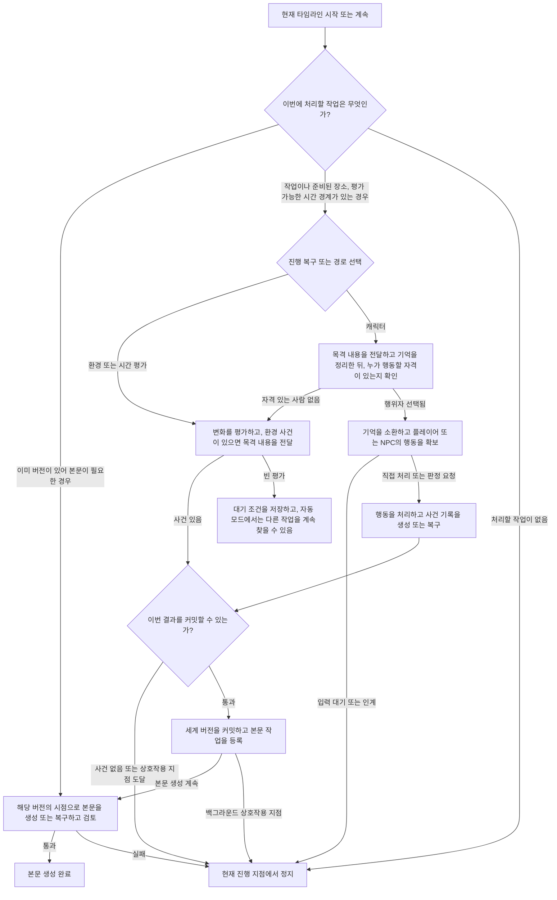

<div align="center">

  
  <h1>JO-ENWSim</h1>

  <h2>줄거리를 짜지 않고, 인과만 추론한다.<br/>세계를 세우고 도입부를 던져 넣으면, 스스로 펼쳐진다.</h2>

  <p>
    <a href="https://jo-beacon.github.io/JO-ENWSim/">공식 사이트</a> ·
    <a href="https://github.com/JO-Beacon/JO-ENWSim">GitHub</a> ·
    <a href="https://github.com/JO-Beacon/JO-ENWSim/releases/latest">최신 버전</a>
  </p>

  <p>
    <a href="./README_en_US.md">English</a> ·
    <a href="./README.md">简体中文</a> ·
    <a href="README.zh-TW.md">繁體中文</a> ·
    <a href="README.ja.md">日本語</a> ·
    <b>한국어</b> ·
    <a href="README.de.md">Deutsch</a> ·
    <a href="README.es.md">Español</a> ·
    <a href="README.fr.md">Français</a> ·
    <a href="README.pt-BR.md">Português</a> ·
    <a href="README.sv.md">Svenska</a>
  </p>

</div>

JO-ENWSim은 창발적 서사 세계 시뮬레이터, 즉 여러 에이전트가 만드는 인과적 샌드박스다. 플레이어는 캐릭터 하나를 조작하고, 나머지 캐릭터는 AI가 각각 구동한다. 각본은 없다. 세계는 인과에 따라 스스로 펼쳐진다.

[English](./README_en_US.md) · [Apache License 2.0](./LICENSE)


위 화면은 작업 공간이다. 왼쪽 레일은 세계 목록, 가운데는 **시퀀스 캔버스**(각 열은 장소, 각 단계는 사건이며, 열을 가로지르는 선은 “장소 이동”을 뜻한다), 오른쪽 위에는 항상 표시되는 **턴 흐름도**(접혀 있을 때는 한 줄만 차지하고, 클릭하면 전체 흐름이 펼쳐진다)가 있고, 그 아래에는 현재 세계의 세부 정보—세계관, 도입부, 캐릭터—가 있다. 기억과 모델은 하단의 “편집” 대화상자에 있다.

## 지금 어떤 상태인가

**이제 실제로 턴을 돌릴 수 있다. 다만 아직 “플레이할 수 있는” 단계는 아니다.**

지금 쓸 수 있는 것:

- 세계 생성, 세계관과 도입부 작성, 캐릭터 추가, 모델 제공자 설정(OpenAI / DeepSeek / Xiaomi MiMo / SiliconFlow …)
- **실제 턴 실행**: 한 단계씩 일시정지하고 재개할 수 있다. 환경 경로와 캐릭터 경로가 각각 사건, 기억, 행동, 판정, 본문을 처리하며, AI 호출과 프로그램 검증, 쓰기는 분리되어 실행된다
- **행동 입력창.** 플레이어가 선언한 행동 원문을 전송하면 작업 공간이 턴을 시작하거나 계속한다. 조작 캐릭터가 행동할 차례가 되거나 경합에 응답할 때에야 파서가 이 원문을 처리해 동작, 대사, 내면을 구분한다. 전송 키 기본값은 `Ctrl+Enter`이고, Enter는 줄바꿈이며, “설정 → 단축키”에서 바꿀 수 있다.
- 세계와 턴은 로컬 SQLite에 저장되어, 닫았다 다시 열어도 그대로 남아 있다
- **검색**: 도구 모음 가장 오른쪽의 지구본이 유일한 진입점이다. 클릭하면 위로 펼쳐지는 메뉴가 나온다. 이 세계의 독립 검색 소스(검색 안 함 / Tavily / DeepSeek)를 고르거나, “한 번 검색…”을 선택해 검색 패널에서 직접 한 번 검색한다. 결과는 다음 환경 업데이트로 넘어간다. 모델 내장 검색은 모델 제공자 기능이며 제공자 설정에서 켜고 환경 업데이트에만 연결된다. 검색 원장은 이미 DB에 기록되며, 턴당 독립 검색 상한은 설정 → 검색 서비스에서 조정할 수 있다(기본 10, 범위 1–100). 자료의 재시작 복구는 아직 구현되지 않았다
- 기억 수동 편집, 단축키 변경
- 오른쪽 패널에서 턴 흐름을 펼치고 현재 단계를 볼 수 있다.
- **행동 입력창 위의 도구 모음**: 이미지 삽입, 파일 삽입(텍스트 / PDF / 이미지), OCR 이미지(내장 PP-OCR, Windows / Android), 사진 촬영(사진만, 동영상 없음)이 모두 연결되어 있다. 스캔 PDF의 빈 텍스트 페이지는 자동으로 렌더링된 뒤 내장 OCR을 거친다
- **TTS**: 시스템 TTS와 API TTS가 연결되어 있다(API TTS는 현재 OpenAI / Xiaomi MiMo 지원). Melo / Kokoro는 AISHELL-3, LJSpeech 등 sherpa-onnx 모델과 마찬가지로 설정 → TTS 서비스 → 모델 → 다운로드 가능한 모델에서 필요할 때 내려받으며, 설치 패키지에 미리 들어 있지 않다. Melo / Kokoro는 바로 합성할 수 있지만, 나머지 다운로드 모델은 아직 합성 엔진에 연결되지 않았다. 턴마다 본문을 소리 내어 읽을 수 있고, 음색, 미리듣기, 캐시도 그곳에 있다
- **기억 에이전트**: encode / reinforce / compress / reinterpret / archive로 캐릭터의 기억을 정리한다. 행동 전에는 자신이 소환할 수 있는 아카이브 원문을 직접 검색하고 읽고 선택할 수 있으며, 예산 제한과 중단 복구를 지원한다

아직 연결되지 않은 것:

- 캐릭터 검색 의도에 대한 영구 기록 / 실패 로그 / 재시작 복구

인터페이스에서 아직 연결되지 않은 곳은 그 자리에서 바로 표시하며, 없는 것을 있는 척하지 않는다.

## 핵심 원칙

- **정보 격리** — 각 캐릭터는 독립된 데이터를 가진다. 어떤 캐릭터를 구동할 때는 그 캐릭터가 아는 것만 볼 수 있고, 다른 캐릭터의 것은 볼 수 없다.
- **플레이어 캐릭터도 특별 대우를 받지 않는다** — 플레이어 캐릭터는 NPC와 동일한 구조다. 유일한 차이는 행동을 플레이어가 결정하며, AI가 대신해서는 안 된다는 점이다.
- **의미를 수치로 환원하지 않는다** — 캐릭터의 상태, 관계, 지각, 행동은 텍스트로 표현하며, 호감도나 능력치, 확률 점수로 압축하지 않는다. 의미를 판단해야 할 곳은 AI에게 맡긴다.

## 작동 방식

일반 캐릭터 턴에서는 먼저 행위자 한 명을 고른다. 다른 캐릭터의 시도가 같은 대상이나 같은 결과를 두고 경합하면, 엔진은 같은 턴에서 여러 사람의 시도를 함께 정산할 수 있다. 환경 턴은 세계 자체의 사건을 진행한다.

| 에이전트 | 역할 |
| --- | --- |
| **신** | 세계를 진행하고, 참여할 캐릭터를 선정하며, 다음 행위자를 결정한다 |
| **캐릭터 지각** | 이 캐릭터가 지금 무엇을 지각하는지 |
| **캐릭터 행동** | 이 캐릭터가 어떻게 행동하는지. NPC는 AI가, 플레이어 캐릭터는 플레이어가 구동한다 |
| **캐릭터 기억** | 이 캐릭터의 기억을 정리하고, 행동 전에 지금 이 순간 기억날 만한 것을 소환한다 |

### 타임라인과 분기

2D 분기 트리로 어느 타임라인의 끝이든 열 수 있고, 분기 턴에서는 “이어 보기”로 그 자리에서 분기할 수도 있다. 분기는 이미 커밋된 턴에서만 열 수 있다. “이 턴 다시 실행”은 마지막으로 완료된 턴에서 새 갈래를 열고 곧바로 추론하므로, 첫 턴에서는 다시 실행할 수 없다.

분기할 때 원래 타임라인은 “백그라운드 추론” 설정(동결, 한 단계, 한 턴, 상호작용 지점까지/자동, 기본값은 한 단계)을 따른다. 재시작 후에는 일괄 동결되고, 수동으로 계속해야 재개된다. 플레이어 입력을 기다리는 동안 같은 타임라인에서는 새 턴을 열지 않으며, 이미 시작된 다른 턴은 정산을 마친 뒤 멈출 수 있다.

“설정 → 엔진 → 자동 추론”에서 모델 동시 실행 상한을 조정할 수 있고 기본값은 1이다. 진행 방식을 “상호작용 지점까지”로 두고 상한이 2 이상이면, 서로 영향이 없다고 확인된 로컬 턴 두 개를 동시에 추론할 수 있다. 공유 상태를 건드리는 턴은 차례로 실행된다.

상단 바의 “진행 방식”은 직접 전송을 누를 때 한 번만 적용된다. 한 단계는 한 단계만 진행하고, 한 턴은 한 턴을 끝까지 실행한다. 플레이어가 없는 세계에는 기다릴 상호작용 지점이 없으므로 이 항목은 “자동”으로 표시된다.

플레이어는 저장된 AI 단계를 편집할 수 있다. 저장소는 모델 원문과 플레이어 수정본을 따로 보관한다. 실행 중인 단계가 끝나면 작업 공간이 작업의 체크포인트에 따라 수정본을 처리한다. 커밋된 턴의 단계를 편집하면 원래 세계 버전과 이후 턴이 유지되고, 본문을 편집하면 표시되는 내용도 바뀔 수 있다. [수정본 저장](lib/data/world_timeline.dart#L400)

### 매 턴의 흐름

아래 그림은 작업 공간의 전송 버튼과 “한 단계”, “상호작용 지점까지” 두 가지 진행 방식을 따라, 세계 버전이 있는 타임라인 하나가 한 번의 조작으로 어디까지 갈 수 있는지 보여 준다.



모델은 계층별로 지정할 수 있다: **캐릭터의 이번 단계 → 캐릭터 기본값 → 세계의 이번 단계 → 세계 기본값 → 전역 이번 단계 → 전역 기본값**.

소프트웨어 오른쪽 패널은 더 적은 노드로 실행 진행을 보여 주며, 예를 들어 현장 판정과 캐릭터 지각은 하나의 하이라이트 위치를 공유한다. [오른쪽 패널 매핑](lib/ui/turn_flow.dart#L21)

## 빌드 및 실행

[Flutter](https://flutter.dev)(stable)가 필요하다. Windows 패키징에는 PowerShell 7과 Inno Setup 6/7이, Android 패키징에는 Android SDK가 추가로 필요하다.

```sh
flutter pub get

# 실행
flutter run -d windows

# Windows release 및 Android 분할 APK 빌드
scripts/build.ps1            # -SkipAndroid를 붙이면 Android 건너뜀
```

TTS 모델은 설치 패키지에 포함되지 않으며, 실행 중에 설정 → TTS 서비스 → 모델 → 다운로드 가능한 모델에서 내려받는다.

산출물:

- Windows: `build/windows/x64/runner/Release/joenws.exe`
- 설치 프로그램(Inno Setup)과 Android 분할 APK(arm / arm64 / x64): `dist/`

## 라이선스

[Apache License 2.0](./LICENSE) · Copyright 2026 JO-Beacon

서드파티 구성 요소와 라이선스 전문은 [NOTICE](./NOTICE)를 참고한다. 앱 안에서도 **설정 → 정보 → 오픈소스 라이선스 보기**에서 볼 수 있다.
