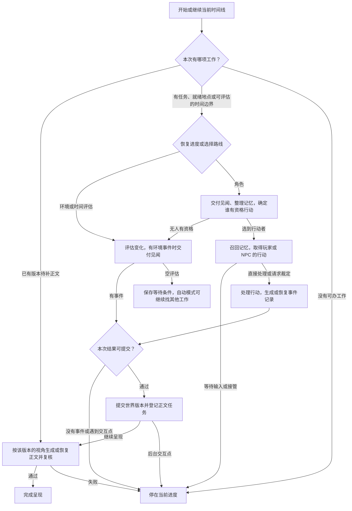

<div align="center">

  
  <h1>JO-ENWSim</h1>

  <h2>不编排剧情，只推演因果。<br/>设定世界，投放开场，让它自行展开。</h2>

  <p>
    <a href="https://jo-beacon.github.io/JO-ENWSim/">官网</a> ·
    <a href="https://github.com/JO-Beacon/JO-ENWSim">GitHub</a> ·
    <a href="https://github.com/JO-Beacon/JO-ENWSim/releases/latest">最新版本</a>
  </p>

  <p>
    <a href="./README_en_US.md">English</a> ·
    <b>简体中文</b> ·
    <a href="README.zh-TW.md">繁體中文</a> ·
    <a href="README.ja.md">日本語</a> ·
    <a href="README.ko.md">한국어</a> ·
    <a href="README.de.md">Deutsch</a> ·
    <a href="README.es.md">Español</a> ·
    <a href="README.fr.md">Français</a> ·
    <a href="README.pt-BR.md">Português</a> ·
    <a href="README.sv.md">Svenska</a>
  </p>

</div>

JO-ENWSim 是一个涌现叙事世界模拟器，一个多 Agent 的因果沙盒。玩家操控一个角色，AI 分别驱动其余角色。没有剧本，世界按因果自行展开。

[English](./README_en_US.md) · [Apache License 2.0](./LICENSE)


上图是工作台：左栏是世界列表，中间是**序列画布**（每一列是一个地点，每一步是一个事件，跨列的线是“换地点”），右栏顶部是常驻的**回合流程图**（收起时只占一行，点一下展开看整条流程），下面是当前世界的详情——世界观、开场、角色；记忆和模型在底部的“编辑”弹窗里。

## 现在是什么状态

**能真的推演了，但还没到“能玩”。**

已经能用：

- 建世界、编世界观与开场、加角色、配模型服务商（OpenAI / DeepSeek / 小米 MiMo / 硅基流动 …）
- **真实回合推演**：支持单步暂停和继续；环境线与角色线分别处理事件、记忆、行动、裁定和正文，AI 调用与程序校验、写入分开执行
- **行动输入框。** 发送玩家声明的行动原文后，工作台开始或继续回合。轮到操控角色行动或回应争用时，解析器才处理这段原文，区分动作、台词和内心。发送键默认 `Ctrl+回车`，回车换行，可在“设置 → 快捷键”调整。
- 世界与回合存在本地 SQLite，关掉再开还在
- **搜索**：工具栏最右边的地球是唯一入口，点开是上拉菜单：选这个世界的独立搜索源（不搜索 / Tavily / DeepSeek），或选“搜索一次…”打开搜索面板手动搜一次；结果交给下一次环境更新。模型自带搜索属于模型服务商能力，在服务商设置里开启，只挂给环境更新。搜索账本已落库，每回合独立搜索上限可在 设置 → 搜索服务 调整（默认 10，范围 1–100）；材料跨重启恢复还没做
- 手动编辑记忆、改快捷键
- 右栏可展开回合流程并查看当前阶段。
- **行动输入框上方的工具栏**：插入图片、插入文件（文本 / PDF / 图片）、OCR图片（内置 PP-OCR，Windows / Android）、拍照（只拍照，不录像）都已接；扫描版 PDF 的空文本页会自动渲染后走内置 OCR。OCR 模型不随安装包，首次启动时询问后下载（约 21 MB），也可在 设置 → 行为 → OCR 模型 里手动下载
- **TTS**：系统 TTS 与接口 TTS 已接（接口 TTS 目前支持 OpenAI / 小米 MiMo）；Melo / Kokoro 与 AISHELL-3、LJSpeech 等 sherpa-onnx 模型一样，在 设置 → TTS 服务 → 模型 → 可下载模型 里按需下载，不随安装包预装；Melo / Kokoro 可直接合成，其余下载模型还没接进合成引擎。可以逐回合朗读正文，音色、试听和缓存也在那里
- **记忆 Agent**：按 encode / reinforce / compress / reinterpret / archive 整理角色记忆；行动前可主动搜索、读取并选择自己的可召回归档原文，支持预算限制与中断恢复

还没接：

- 角色搜索意图的持久化账本 / 失败记录 / 重启恢复

界面里凡是没有接上的地方，都会当场标出来，不会装作没事。

## 核心原则

- **信息隔离**——每个角色有独立的数据。驱动某个角色时，只能看到该角色知道的，看不到别的。
- **玩家角色不搞特殊**——玩家角色与 NPC 同构；唯一区别是它的行为由玩家决定，AI 不得代替。
- **不把语义简化为数值**——角色的状态、关系、感知和行动用文本表达，不压成好感度、属性值或概率分；该判断语义的地方交给 AI。

## 如何运作

普通角色回合先选出一名行动者。若其他角色的尝试与其争用同一件东西或影响同一结果，引擎可以在同一回合结算多人的尝试。环境回合推进世界自身的事件。

| Agent | 职责 |
| --- | --- |
| **上帝** | 推进世界、框选参与的角色、决定下一位行动者 |
| **角色感知** | 该角色此刻感知到了什么 |
| **角色行为** | 该角色如何行动；NPC 由 AI 驱动，玩家角色由玩家驱动 |
| **角色记忆** | 整理该角色的记忆，并在行动前召回它此刻会想起的事 |

### 时间线与分支

用二维分支树打开任意时间线的末尾，也可以在分岔回合通过“查看后续”就地切线。只有已提交的回合能开分支。“重推本回合”从上一已完成回合开新线并立即推演，因此首回合不可重推。

切线时原线按“后台推演”设置运行（冻结、单步、单回合、直到交互点/自动，默认单步）。重启后一律冻结，手动继续才恢复。等待玩家输入时，同一条线不再开新回合，已开跑的其他回合可以结算完再停。

“设置 → 引擎 → 自动推演”可调整模型并发上限，默认 1。推进方式选“直到交互点”、上限至少为 2 时，可同时推演两个确认互不影响的本地回合；涉及共享状态的回合依次执行。

顶栏的“推进方式”只管你手动点发送这一下：单步只走一个阶段，单回合跑一回合。没有玩家的世界没有交互点可等，这一档显示成“自动”。

玩家可编辑已存储的 AI 步骤。存档分别保存模型原文与玩家修订。正在执行的步骤结束后，工作台按任务的检查点处理修订。编辑已提交回合里的步骤会保留原世界版本和后续回合，编辑正文还可改变呈现内容。[修订存储](lib/data/world_timeline.dart#L400)

### 每回合的流程

下面这张图沿工作台的发送按钮，以及“单步”“直到交互点”两个推进方式，展示一条有世界版本的时间线，看一次操作可能走到哪里。



模型可以按层指定：**角色自己的这一步 → 角色默认 → 世界这一步 → 世界默认 → 全局这一步 → 全局默认**。

软件右栏按较少的节点显示运行进度，例如现场裁定和角色感知共用一个高亮位置。[右栏映射](lib/ui/turn_flow.dart#L21)

## 构建与运行

需要 [Flutter](https://flutter.dev)（stable）。Windows 打包还需要 PowerShell 7 与 Inno Setup 6/7；安卓打包需要 Android SDK。

```sh
flutter pub get

# 跑起来
flutter run -d windows

# 出 Windows release 与安卓分体 APK
scripts/build.ps1            # 加 -SkipAndroid 可跳过安卓
```

TTS 模型不随安装包，运行时在 设置 → TTS 服务 → 模型 → 可下载模型 里下载。

产物：

- Windows：`build/windows/x64/runner/Release/joenws.exe`
- 安装程序（Inno Setup）与安卓分体 APK（arm / arm64 / x64）：`dist/`

## 许可

[Apache License 2.0](./LICENSE) · Copyright 2026 JO-Beacon

第三方组件与许可全文见 [NOTICE](./NOTICE)；应用内也可以在 **设置 → 关于 → 查看开源许可** 里看。
