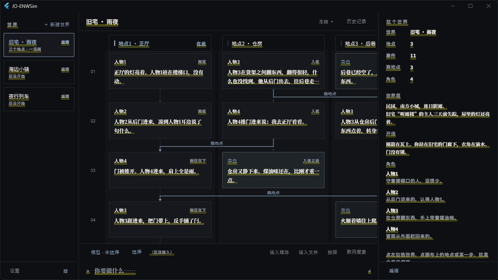

# JO-ENWSim

**Emergent Narrative World Simulator**
No plot. Just causality.

> 不编排剧情，只推演因果。
> 设定世界，投放开场，让它自行展开。

JO-ENWSim 是一个涌现叙事模拟器，一个多 Agent 的因果沙盒。玩家操控一个角色，AI 分别驱动其余角色。没有剧本，世界按因果自行展开。

[English](./README_en_US.md) · [Apache License 2.0](./LICENSE)



上图是工作台：左栏是世界列表，中间是**序列画布**（每一列是一个地点，每一步是一个事件，跨列的线是「换地点」），右栏是这个世界本身——世界观、开场、角色、记忆、模型。

## 现在是什么状态

**界面能看能点，引擎还没接入。**

- 可以：建世界、编世界观与开场、加角色、配模型服务商、写记忆、改快捷键
- 还不可以：**让世界真正推进**。接上模型之前，画布里的是演示数据，输入框发出的话不会进世界

界面里凡是没有接上的地方，都会当场标出来，不会装作没事。

## 核心原则

- **信息隔离**——每个角色有独立的数据。驱动某个角色时，只能看到该角色知道的，看不到别的。
- **不喂历史原文**——不把整段历史塞给模型，只给它此刻该知道的：角色自己的记忆，加上它这一刻感知到的东西。
- **玩家角色不搞特殊**——玩家角色与 NPC 同构；唯一区别是它的行为由玩家决定，AI 不得代替。

## 如何运作

基本单位：**一个角色的一次行为 = 一回合**。三种 Agent 共用一条流程：

| Agent | 职责 |
| --- | --- |
| **上帝**（AI，全知） | 推进世界、框选参与的角色、决定下一位行动者 |
| **角色感知**（每个角色一份，AI） | 该角色此刻感知到了什么 |
| **角色行为**（每个角色一份） | 该角色如何行动；NPC 由 AI 驱动，玩家角色由玩家驱动 |

模型可以按层指定，从细到粗：**角色自己的某一步 → 世界默认 → 全局默认**。

## 构建与运行

需要 [Flutter](https://flutter.dev)（stable）。

```sh
flutter pub get

# 跑起来
flutter run -d windows

# 出 Windows release
scripts/build.ps1            # 加 -SkipAndroid 可跳过安卓
```

产物：

- Windows：`build/windows/x64/runner/Release/joenws.exe`
- 安装程序（Inno Setup）与安卓分体式 APK：`dist/`

## 命名

| 用途 | 名称 |
| --- | --- |
| 产品 / 仓库 | `JO-ENWSim` |
| Dart 包 | `joenws` |
| 可执行文件 | `joenws.exe` |
| 安卓包名 | `io.github.jobeacon.joenws` |

产品名用 `JO-ENWSim`；代码标识用 `joenws`。

## 许可

[Apache License 2.0](./LICENSE) · Copyright 2026 JO-Beacon

随本项目分发的第三方组件见 [NOTICE](./NOTICE)，包括：

- Flutter、Dart（BSD-3-Clause）
- Noto Sans SC / Noto Serif SC（SIL OFL 1.1）
- Remix Icon（Remix Icon License v1.0）

各家的许可全文在 [`assets/licenses/`](./assets/licenses)，也可以在应用里看：**设置 → 关于 → 查看开源许可**。
