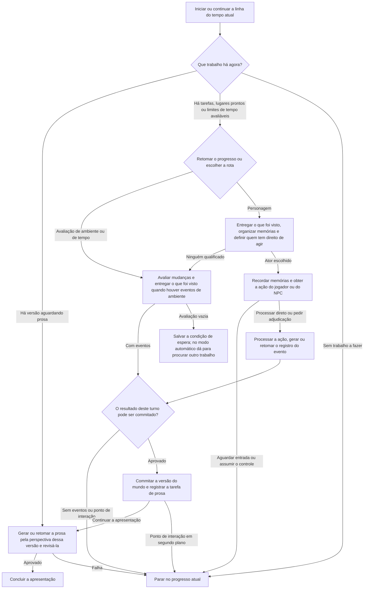

<div align="center">

  
  <h1>JO-ENWSim</h1>

  <h2>Sem roteiro, só causalidade.<br/>Defina o mundo, insira a abertura e deixe-o se desenrolar sozinho.</h2>

  <p>
    <a href="https://jo-beacon.github.io/JO-ENWSim/">Site oficial</a> ·
    <a href="https://github.com/JO-Beacon/JO-ENWSim">GitHub</a> ·
    <a href="https://github.com/JO-Beacon/JO-ENWSim/releases/latest">Última versão</a>
  </p>

  <p>
    <a href="./README_en_US.md">English</a> ·
    <a href="./README.md">简体中文</a> ·
    <a href="README.zh-TW.md">繁體中文</a> ·
    <a href="README.ja.md">日本語</a> ·
    <a href="README.ko.md">한국어</a> ·
    <a href="README.de.md">Deutsch</a> ·
    <a href="README.es.md">Español</a> ·
    <a href="README.fr.md">Français</a> ·
    <b>Português</b> ·
    <a href="README.sv.md">Svenska</a>
  </p>

</div>

JO-ENWSim é um simulador de mundo narrativo emergente, uma sandbox causal multiagente. O jogador controla um personagem e a IA conduz cada um dos demais. Não há roteiro: o mundo se desenrola pela causalidade.

[English](./README_en_US.md) · [Apache License 2.0](./LICENSE)


A imagem acima é a área de trabalho: a coluna esquerda lista os mundos, o centro é o **canvas de sequência** (cada coluna é um lugar, cada passo é um evento e as linhas que cruzam colunas são “mudanças de lugar”), e no topo da coluna direita fica o **diagrama de fluxo do turno** sempre presente (recolhido ocupa uma linha só e um clique o abre por inteiro), abaixo dele os detalhes do mundo atual — cenário, abertura e personagens; memórias e configuração de modelos ficam no diálogo “Editar” na parte inferior.

## Status atual

**Já dá para executar turnos de verdade, mas ainda não dá para “jogar”.**

O que já funciona:

- Criar mundos, escrever o cenário e a abertura, adicionar personagens, configurar provedores de modelo (OpenAI / DeepSeek / Xiaomi MiMo / SiliconFlow …)
- **Execução real de turnos**: com pausa e retomada por etapa; as rotas de ambiente e de personagem tratam eventos, memória, ação, adjudicação e prosa separadamente, e as chamadas de IA correm à parte da validação pelo programa e das gravações
- **Campo de ação.** Depois que o texto original da ação declarada pelo jogador é enviado, a área de trabalho inicia ou retoma o turno. Só quando chega a vez de o personagem controlado agir ou responder a uma disputa o analisador processa esse texto, distinguindo ação, fala e pensamento. A tecla de envio padrão é `Ctrl+Enter`, o Enter quebra a linha, e ambas podem ser trocadas em “Configurações → Atalhos”.
- Mundos e turnos ficam em um SQLite local e continuam lá depois de fechar e abrir de novo
- **Busca**: o globo na extremidade direita da barra de ferramentas é a única entrada; ao abri-lo surge um menu voltado para cima: escolher a fonte de busca independente deste mundo (sem busca / Tavily / DeepSeek) ou selecionar “Buscar uma vez…” para abrir o painel de busca e fazer uma busca manual; o resultado vai para a próxima atualização de ambiente. A busca embutida no modelo é uma capacidade do provedor, habilitada nas configurações do provedor, e só é anexada à atualização de ambiente. O registro de buscas já está no banco, e o limite de buscas independentes por turno pode ser ajustado em Configurações → Serviço de Busca (padrão 10, faixa 1–100); a recuperação de material após reiniciar ainda não foi feita
- Editar memórias manualmente e alterar atalhos
- O painel direito pode expandir o fluxo do turno e mostra a etapa atual.
- **A barra de ferramentas acima do campo de ação**: inserir imagem, inserir arquivo (texto / PDF / imagem), OCR de imagem (PP-OCR integrado, Windows / Android) e tirar foto (só foto, sem vídeo) já estão conectados; páginas sem texto de PDFs digitalizados são renderizadas automaticamente e passam pelo OCR integrado
- **TTS**: TTS do sistema e TTS por API já estão conectados (o TTS por API hoje suporta OpenAI / Xiaomi MiMo); Melo / Kokoro, assim como os outros modelos sherpa-onnx (AISHELL-3, LJSpeech etc.), são baixados sob demanda em Configurações → Serviço TTS → Modelos → Modelos para download e não vêm no instalador; Melo / Kokoro sintetizam direto, e os demais modelos baixados ainda não foram ligados ao motor de síntese. Dá para ler a prosa em voz alta turno a turno; as vozes, a prévia e o cache também ficam lá
- **Agente de Memória**: organiza a memória do personagem com encode / reinforce / compress / reinterpret / archive; antes de agir, pode buscar, ler e escolher ativamente seus próprios textos arquivados recordáveis, com limite de orçamento e recuperação de interrupções

Ainda não conectado:

- Registro persistente das intenções de busca dos personagens / registro de falhas / recuperação após reinício

Tudo o que ainda não está conectado na interface é sinalizado na hora, sem fingir que está tudo bem.

## Princípios fundamentais

- **Isolamento de informação** — cada personagem tem dados próprios. Ao conduzir um personagem, só se vê o que aquele personagem sabe, nunca o dos outros.
- **O personagem do jogador não recebe tratamento especial** — é estruturalmente idêntico a um NPC; a única diferença é que seu comportamento é decidido pelo jogador, e a IA não pode agir em seu lugar.
- **Não reduzir a semântica a números** — o estado, as relações, as percepções e as ações dos personagens são expressos em texto, sem serem comprimidos em pontos de afinidade, valores de atributo ou probabilidades; onde é preciso julgar a semântica, a decisão fica com a IA.

## Como funciona

Nos turnos de personagem, primeiro se escolhe um ator. Se as tentativas de outros personagens disputam o mesmo objeto ou afetam o mesmo resultado, o motor pode resolver as tentativas de várias pessoas no mesmo turno. Os turnos de ambiente avançam os eventos do próprio mundo.

| Agente | Responsabilidade |
| --- | --- |
| **Deus** | Avança o mundo, delimita os personagens participantes e decide quem age em seguida |
| **Percepção do personagem** | O que esse personagem percebe neste momento |
| **Ação do personagem** | Como esse personagem age; NPCs são conduzidos pela IA e o personagem do jogador pelo jogador |
| **Memória do personagem** | Organiza a memória desse personagem e recorda o que ele lembraria neste momento antes de agir |

### Linhas do tempo e ramificações

Abra o fim de qualquer linha do tempo pela árvore de ramificação bidimensional, ou ramifique no próprio ponto de bifurcação com “Ver continuações”. Só turnos já commitados podem gerar um ramo. “Reexecutar este turno” abre uma nova linha a partir do último turno concluído e já executa na hora, por isso o primeiro turno não pode ser reexecutado.

Ao ramificar, a linha original roda conforme a configuração de “execução em segundo plano” (congelar, um passo, um turno, até um ponto de interação/automático; padrão um passo). Após reiniciar, tudo fica congelado e só volta ao continuar manualmente. Enquanto aguarda entrada do jogador, a mesma linha não abre novos turnos; os outros turnos já iniciados podem terminar antes de parar.

“Configurações → Motor → Execução automática” ajusta o limite de chamadas de modelo simultâneas, padrão 1. Com o modo de avanço “até um ponto de interação” e o limite em pelo menos 2, dois turnos locais que comprovadamente não se afetam podem rodar ao mesmo tempo; turnos que envolvem estado compartilhado executam em sequência.

O “modo de avanço” da barra superior vale só para o envio manual: um passo percorre uma única etapa, e um turno roda um turno. Um mundo sem jogador não tem ponto de interação para aguardar, então essa opção aparece como “automático”.

O jogador pode editar etapas de IA já armazenadas. O arquivo guarda separadamente o texto original do modelo e a revisão do jogador. Terminada a etapa em execução, a área de trabalho trata a revisão conforme os checkpoints da tarefa. Editar etapas de turnos já commitados preserva a versão original do mundo e os turnos seguintes, e editar a prosa também pode mudar o conteúdo apresentado. [Armazenamento das revisões](lib/data/world_timeline.dart#L400)

### Fluxo de um turno

O diagrama abaixo acompanha o botão de envio da área de trabalho e os dois modos de avanço “um passo” e “até um ponto de interação”, mostrando uma linha do tempo com versão do mundo e até onde uma operação pode chegar.



Modelos podem ser atribuídos por camadas: **a etapa própria do personagem → o padrão do personagem → a etapa do mundo → o padrão do mundo → a etapa global → o padrão global**.

O painel direito do aplicativo mostra o progresso com menos nós, por exemplo, a adjudicação em cena e a percepção do personagem compartilham o mesmo destaque. [Mapeamento do painel direito](lib/ui/turn_flow.dart#L21)

## Compilação e execução

Requer [Flutter](https://flutter.dev) (stable). Para empacotar o Windows também são necessários PowerShell 7 e Inno Setup 6/7; para o Android é preciso o Android SDK.

```sh
flutter pub get

# rodar
flutter run -d windows

# gerar o release do Windows e os APKs split do Android
scripts/build.ps1            # com -SkipAndroid para pular o Android
```

Os modelos TTS não vêm no instalador: eles são baixados em tempo de execução em Configurações → Serviço TTS → Modelos → Modelos para download.

Artefatos:

- Windows: `build/windows/x64/runner/Release/joenws.exe`
- Instalador (Inno Setup) e APKs split por ABI do Android (arm / arm64 / x64): `dist/`

## Licença

[Apache License 2.0](./LICENSE) · Copyright 2026 JO-Beacon

Componentes de terceiros e o texto integral da licença estão em [NOTICE](./NOTICE); também dá para vê-los dentro do aplicativo em **Configurações → Sobre → Ver licenças de código aberto**.
