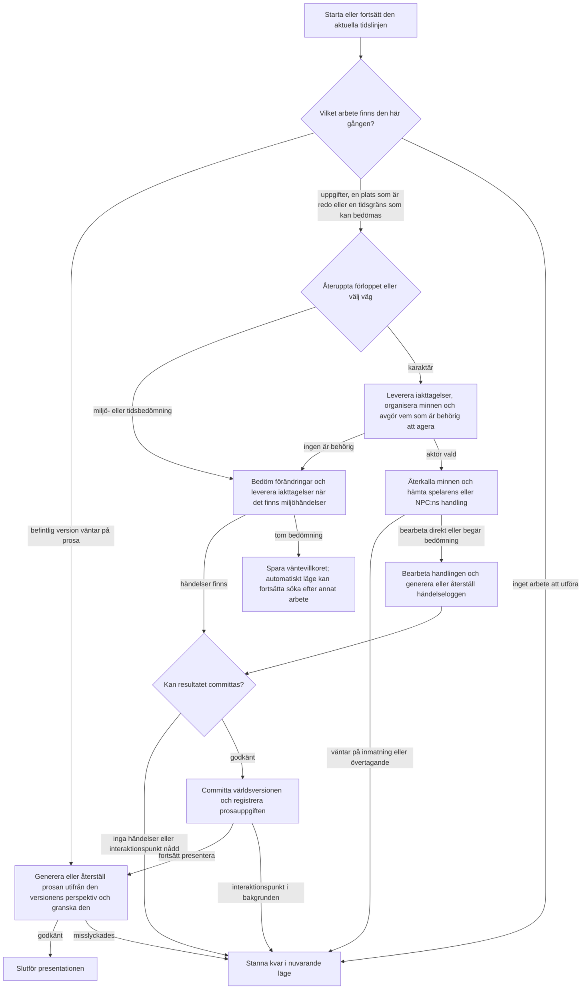

<div align="center">

  
  <h1>JO-ENWSim</h1>

  <h2>Inget manus. Bara kausalitet.<br/>Skapa en värld, lägg in en inledning och låt den utvecklas.</h2>

  <p>
    <a href="https://jo-beacon.github.io/JO-ENWSim/">Webbplats</a> ·
    <a href="https://github.com/JO-Beacon/JO-ENWSim">GitHub</a> ·
    <a href="https://github.com/JO-Beacon/JO-ENWSim/releases/latest">Senaste versionen</a>
  </p>

  <p>
    <a href="./README_en_US.md">English</a> ·
    <a href="./README.md">简体中文</a> ·
    <a href="README.zh-TW.md">繁體中文</a> ·
    <a href="README.ja.md">日本語</a> ·
    <a href="README.ko.md">한국어</a> ·
    <a href="README.de.md">Deutsch</a> ·
    <a href="README.es.md">Español</a> ·
    <a href="README.fr.md">Français</a> ·
    <a href="README.pt-BR.md">Português</a> ·
    <b>Svenska</b>
  </p>

</div>

JO-ENWSim är en emergent narrativ världssimulator, en kausal sandlåda med flera agenter. Spelaren styr en karaktär och AI:n driver de övriga. Det finns inget manus; världen utvecklas genom kausalitet.

[English](./README_en_US.md) · [Apache License 2.0](./LICENSE)


Bilden ovan visar arbetsytan: den vänstra kolumnen är världslistan, mitten är **sekvensytan** (varje kolumn är en plats, varje steg är en händelse och en linje som korsar kolumner betyder ”byte av plats”), högst upp i den högra kolumnen finns det alltid synliga **turflödesdiagrammet** (ihopfällt tar det bara en rad; klicka för att expandera hela flödet), och under det visas information om den aktuella världen – världsbeskrivning, inledning och karaktärer. Minnen och modeller finns i dialogrutan ”Redigera” längst ner.

## Nuvarande status

**Simuleringen fungerar nu på riktigt, men det är ännu inte spelbart.**

Det här fungerar redan:

- Skapa världar, skriva världsbeskrivning och inledning, lägga till karaktärer och konfigurera modellleverantörer (OpenAI / DeepSeek / Xiaomi MiMo / SiliconFlow …)
- **Riktig turkörning**: stöd för paus och återupptagning ett steg i taget; miljölinjen och karaktärslinjerna hanterar händelser, minnen, handlingar, bedömning och prosatext var för sig, medan AI-anrop, programvalidering och skrivning utförs som separata operationer
- **Fältet för handlingar.** När spelaren har skickat originaltexten för sin deklarerade handling startar eller fortsätter arbetsytan turen. Först när den spelarstyrda karaktären ska agera eller svara på en konflikt bearbetar tolken texten och skiljer mellan handling, replik och inre tankar. Skicka-knappen är som standard `Ctrl+Enter`; Retur infogar en radbrytning, och inställningen kan ändras under Inställningar → Kortkommandon.
- Världar och turer lagras i en lokal SQLite-databas och finns kvar när du stänger och öppnar programmet igen
- **Sökning**: jordgloben längst till höger i verktygsfältet är den enda ingången; klickar du på den öppnas en meny som fälls upp där du väljer den fristående sökkällan för den här världen (Ingen sökning / Tavily / DeepSeek) eller ”Sök en gång…” för att öppna sökpanelen och göra en manuell sökning; resultaten lämnas till nästa miljöuppdatering. Modellens inbyggda sökning är en funktion hos modellleverantören, aktiveras i leverantörsinställningarna och kopplas endast till miljöuppdateringen. Sökloggen finns nu i databasen, och gränsen för fristående sökningar per tur kan ställas in under Inställningar → Söktjänst (standard 10, intervall 1–100); återställning av material mellan omstarter är ännu inte implementerad
- Manuell redigering av minnen och ändring av kortkommandon
- I den högra kolumnen kan du fälla ut turflödet och se den aktuella fasen.
- **Verktygsfältet ovanför handlingsfältet**: infogning av bilder, infogning av filer (text / PDF / bild), OCR på bilder (inbyggd PP-OCR, Windows / Android) och kamera (endast stillbilder, ingen video) är alla inkopplade; tomma textsidor i skannade PDF:er renderas automatiskt och bearbetas sedan av den inbyggda OCR:en
- **TTS**: system-TTS och API-TTS är inkopplade (API-TTS stöder för närvarande OpenAI / Xiaomi MiMo); Melo / Kokoro laddas ner efter behov, precis som sherpa-onnx-modeller som AISHELL-3 och LJSpeech, under Inställningar → TTS-tjänst → Modeller → Nedladdningsbara modeller och förinstalleras inte med paketet. Melo / Kokoro kan syntetisera direkt, medan de övriga nedladdade modellerna ännu inte är anslutna till syntesmotorn. Du kan läsa upp prosan tur för tur, och röster, förhandslyssning och cache finns också där
- **Minnesagent**: organiserar karaktärens minnen enligt encode / reinforce / compress / reinterpret / archive; före en handling kan den aktivt söka i, läsa och välja bland sina egna återkallbara arkivposter, med budgetgränser och återhämtning efter avbrott

Ännu inte inkopplat:

- Beständigt register, felloggar och återställning efter omstart för karaktärernas sökavsikter

Allt i gränssnittet som ännu inte är inkopplat markeras direkt – det låtsas inte som att allt fungerar.

## Grundprinciper

- **Informationsisolering** – varje karaktär har sina egna data. När en karaktär drivs ser den bara det som karaktären vet, aldrig något annat.
- **Spelarkaraktären får ingen särbehandling** – spelarkaraktären är strukturellt identisk med en NPC; den enda skillnaden är att spelaren bestämmer dess handlingar, och AI:n får inte göra det i stället.
- **Semantik ska inte reduceras till siffror** – en karaktärs tillstånd, relationer, perception och handlingar uttrycks i text och pressas inte samman till affinitetspoäng, attributvärden eller sannolikhetspoäng; den semantiska bedömningen lämnas till AI:n.

## Så fungerar det

En vanlig karaktärstur börjar med att en aktör väljs ut. Om andra karaktärers försök konkurrerar om samma sak eller påverkar samma resultat kan motorn avgöra flera personers försök under samma tur. En miljötur driver världens egna händelser framåt.

| Agent | Ansvar |
| --- | --- |
| **Gud** | Driver världen framåt, väljer ut deltagande karaktärer och bestämmer vem som agerar härnäst |
| **Karaktärsperception** | Vad den här karaktären uppfattar just nu |
| **Karaktärshandling** | Hur den här karaktären agerar; NPC:er drivs av AI:n, spelarkaraktären av spelaren |
| **Karaktärsminne** | Organiserar den här karaktärens minnen och återkallar före en handling det som karaktären skulle minnas just nu |

### Tidslinjer och grenar

Du kan öppna slutet av vilken tidslinje som helst i grenarnas tvådimensionella träd, eller förgrena på plats vid en förgreningstur via ”Visa fortsättning”. Endast turer som har slutförts och sparats kan bli en utgångspunkt för en gren. ”Kör om den här turen” skapar en ny linje från föregående slutförda tur och simulerar omedelbart, så den första turen kan inte köras om.

När du förgrenar fortsätter den ursprungliga linjen enligt inställningen för ”bakgrundssimulering” (fryst, ett steg, en tur, till interaktionspunkt/automatiskt; standard är ett steg). Efter en omstart fryses alla linjer och återupptas först när du fortsätter manuellt. När en linje väntar på spelarens inmatning startas inga nya turer på samma linje, medan andra turer som redan har startat får göras klart innan de stannar.

Under Inställningar → Motor → Automatisk simulering kan du ställa in det högsta antalet samtidiga modellanrop; standard är 1. Om avanceringsläget är ”Till interaktionspunkt” och gränsen är minst 2 kan två lokala turer som bedöms vara oberoende av varandra simuleras samtidigt; turer som delar tillstånd körs i tur och ordning.

”Avanceringsläge” i det översta fältet styr bara när du själv klickar på Skicka: ”Ett steg” går bara en fas framåt och ”En tur” kör en hel tur. Världar utan spelare har ingen interaktionspunkt att vänta på, så det läget visas som ”Automatiskt”.

Spelaren kan redigera sparade AI-steg. Sparfilen lagrar modellens originaltext och spelarens revideringar separat. När steget som körs har slutförts hanterar arbetsytan revideringarna enligt uppgiftens kontrollpunkt. Om du redigerar ett steg i en sparad tur bevaras den ursprungliga världsversionen och de efterföljande turerna; om du redigerar prosan kan även det som visas ändras. [Lagring av revideringar](lib/data/world_timeline.dart#L400)

### En turs flöde

Diagrammet nedan följer arbetsytans skicka-knapp och lägena ”Ett steg” och ”Till interaktionspunkt” och visar, längs en tidslinje med världsversioner, hur långt en åtgärd kan nå.



Modeller kan anges i lager: **karaktärens eget steg → karaktärens standard → världens steg → världens standard → det globala steget → den globala standarden**.

Programmets högerkolumn visar körförloppet med färre noder; till exempel delar bedömning i stunden och karaktärsperception en markerad position. [Högerkolumnens mappning](lib/ui/turn_flow.dart#L21)

## Bygg och kör

Kräver [Flutter](https://flutter.dev) (stable). För Windows-bygget krävs även PowerShell 7 och Inno Setup 6/7; för Android-bygget krävs Android SDK.

```sh
flutter pub get

# 跑起来
flutter run -d windows

# 出 Windows release 与安卓分体 APK
scripts/build.ps1            # 加 -SkipAndroid 可跳过安卓
```

TTS-modellerna ingår inte i installationspaketet; de laddas ner vid behov under Inställningar → TTS-tjänst → Modeller → Nedladdningsbara modeller.

Artefakter:

- Windows: `build/windows/x64/runner/Release/joenws.exe`
- Installationsprogram (Inno Setup) och Android-APK:er med split-per-ABI (arm / arm64 / x64): `dist/`

## Licens

[Apache License 2.0](./LICENSE) · Copyright 2026 JO-Beacon

Tredjepartskomponenter och fullständiga licenstexter finns i [NOTICE](./NOTICE); de kan även läsas i appen under **Inställningar → Om → Visa öppna källkodslicenser**.
