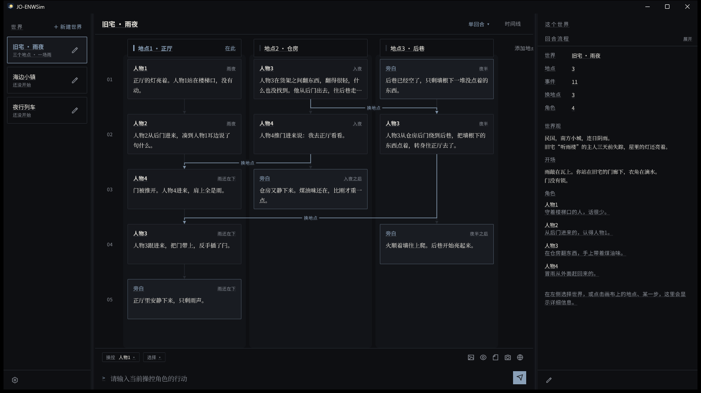
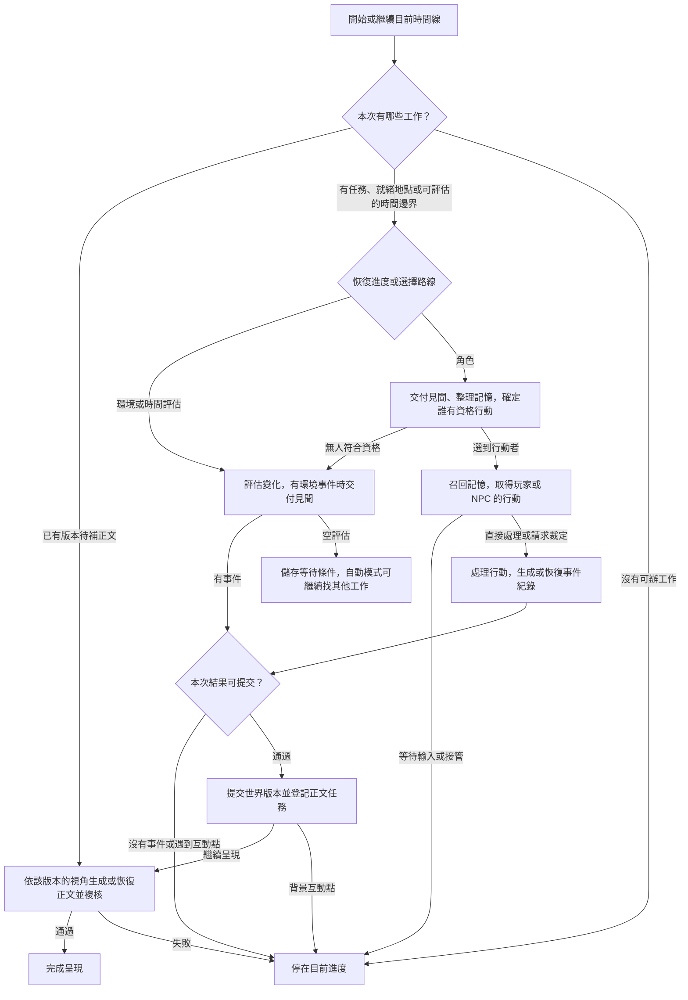

<div align="center">

  
  <h1>JO-ENWSim</h1>

  <h2>不編排劇情，只推演因果。<br/>設定世界，投放開場，讓它自行展開。</h2>

  <p>
    <a href="https://jo-beacon.github.io/JO-ENWSim/">官網</a> ·
    <a href="https://github.com/JO-Beacon/JO-ENWSim">GitHub</a> ·
    <a href="https://github.com/JO-Beacon/JO-ENWSim/releases/latest">最新版本</a>
  </p>

  <p>
    <a href="./README_en_US.md">English</a> ·
    <a href="./README.md">简体中文</a> ·
    <b>繁體中文</b> ·
    <a href="README.ja.md">日本語</a> ·
    <a href="README.ko.md">한국어</a> ·
    <a href="README.de.md">Deutsch</a> ·
    <a href="README.es.md">Español</a> ·
    <a href="README.fr.md">Français</a> ·
    <a href="README.pt-BR.md">Português</a> ·
    <a href="README.sv.md">Svenska</a>
  </p>

</div>

JO-ENWSim 是一個湧現式敘事世界模擬器，一個多 Agent 的因果沙盒。玩家操控一個角色，AI 分別驅動其餘角色。沒有劇本，世界依因果自行展開。

[English](./README_en_US.md) · [Apache License 2.0](./LICENSE)



上圖是工作台：左欄是世界列表，中間是**序列畫布**（每一欄是一個地點，每一步是一個事件，跨欄的線是“換地點”），右欄頂端是常駐的**回合流程圖**（收起時只佔一行，點一下展開就能看整條流程），下面是目前世界的詳情——世界觀、開場、角色；記憶和模型則在底部的“編輯”對話框裡。

## 目前狀態

**已經能真的推演了，但還沒到“能玩”的地步。**

已經能用：

- 建立世界、撰寫世界觀與開場、新增角色、設定模型供應商（OpenAI / DeepSeek / 小米 MiMo / SiliconFlow …）
- **真實回合推演**：支援單步暫停與繼續；環境線與角色線分別處理事件、記憶、行動、裁定與正文，AI 呼叫與程式校驗、寫入分開執行
- **行動輸入框。** 送出玩家宣告的行動原文後，工作台開始或繼續回合。輪到操控角色行動或回應爭奪時，解析器才處理這段原文，區分動作、台詞和內心。送出鍵預設為 `Ctrl+Enter`，Enter 換行，可在“設定 → 快速鍵”調整。
- 世界與回合存在本機 SQLite，關掉再開還在
- **搜尋**：工具列最右邊的地球是唯一入口，點開後是彈出選單：選擇這個世界的獨立搜尋來源（不搜尋 / Tavily / DeepSeek），或選“搜尋一次…”開啟搜尋面板手動搜一次；結果交給下一次環境更新。模型內建搜尋屬於模型供應商能力，在供應商設定裡開啟，只掛給環境更新。搜尋紀錄已寫入資料庫，每回合的獨立搜尋上限可在 設定 → 搜尋服務 調整（預設 10，範圍 1–100）；材料跨重新啟動的復原還沒做
- 手動編輯記憶、修改快速鍵
- 右欄可展開回合流程並查看目前階段。
- **行動輸入框上方的工具列**：插入圖片、插入檔案（文字 / PDF / 圖片）、OCR 圖片（內建 PP-OCR，Windows / Android）、拍照（只拍照，不錄影）都已接通；掃描版 PDF 的空文字頁面會自動轉成影像，再交給內建 OCR 處理
- **TTS**：系統 TTS 與供應商 TTS 已接通（供應商 TTS 目前支援 OpenAI / 小米 MiMo）；Melo / Kokoro 與 AISHELL-3、LJSpeech 等 sherpa-onnx 模型一樣，在 設定 → TTS 服務 → 模型 → 可下載模型 裡視需要下載，不隨安裝包預裝；Melo / Kokoro 可直接合成，其餘下載模型還沒接進合成引擎。可以逐回合朗讀正文，音色、試聽與快取也在那裡
- **記憶 Agent**：按 encode / reinforce / compress / reinterpret / archive 整理角色記憶；行動前可主動搜尋、讀取並選擇自己的可召回歸檔原文，支援預算限制與中斷復原

還沒接：

- 角色搜尋意圖的持久化帳本 / 失敗紀錄 / 重新啟動復原

介面裡凡是還沒接通的地方，都會當場標示出來，不會假裝沒事。

## 核心原則

- **資訊隔離**——每個角色都有獨立的資料。驅動某個角色時，只能看到該角色知道的，看不到別的。
- **玩家角色不享有特權**——玩家角色與 NPC 的結構完全相同；唯一差別是它的行為由玩家決定，AI 不得代替。
- **不把語意簡化為數值**——角色的狀態、關係、感知和行動用文字表達，不壓成好感度、屬性值或機率分數；該判斷語意的地方交給 AI。

## 如何運作

普通角色回合先選出一名行動者。若其他角色的嘗試與其爭奪同一件東西或影響同一結果，引擎可以在同一回合結算多人的嘗試。環境回合推進世界自身的事件。

| Agent | 職責 |
| --- | --- |
| **上帝** | 推進世界、框選參與的角色、決定下一位行動者 |
| **角色感知** | 該角色此刻感知到了什麼 |
| **角色行為** | 該角色如何行動；NPC 由 AI 驅動，玩家角色由玩家驅動 |
| **角色記憶** | 整理該角色的記憶，並在行動前召回它此刻會想起的事 |

### 時間線與分支

用二維分支樹開啟任意時間線的末尾，也可以在分岔回合透過“查看後續”就地切線。只有已提交的回合能開分支。“重推本回合”從上一個已完成回合開新線並立即推演，因此首回合無法重推。

切線時原線依“背景推演”設定執行（凍結、單步、單回合、直到互動點／自動，預設單步）。重新啟動後一律凍結，手動繼續才恢復。等待玩家輸入時，同一條線不再開新回合，已開跑的其他回合可以結算完再停。

“設定 → 引擎 → 自動推演”可調整模型並行上限，預設 1。推進方式選“直到互動點”、上限至少為 2 時，可同時推演兩個經確認互不影響的本地回合；涉及共享狀態的回合依序執行。

頂欄的“推進方式”只管你手動按下送出的這一下：單步只走一個階段，單回合跑一回合。沒有玩家的世界沒有互動點可等，這一項會顯示成“自動”。

玩家可以編輯已儲存的 AI 步驟。存檔會分別儲存模型原文與玩家修訂。正在執行的步驟結束後，工作台會依任務的檢查點處理修訂。編輯已提交回合裡的步驟會保留原世界版本與後續回合；編輯正文還可以改變呈現內容。[修訂儲存](lib/data/world_timeline.dart#L400)

### 每回合的流程

下面這張圖沿著工作台的送出按鈕，以及“單步”“直到互動點”兩個推進方式，展示一條有世界版本的時間線，看一次操作可能走到哪裡。



模型可以分層指定：**角色自己的這一步 → 角色預設 → 世界這一步 → 世界預設 → 全域這一步 → 全域預設**。

軟體右欄以較少的節點顯示執行進度，例如現場裁定與角色感知共用一個高亮位置。[右欄映射](lib/ui/turn_flow.dart#L21)

## 建置與執行

需要 [Flutter](https://flutter.dev)（stable）。Windows 打包還需要 PowerShell 7 與 Inno Setup 6/7；Android 打包需要 Android SDK。

```sh
flutter pub get

# 跑起來
flutter run -d windows

# 出 Windows release 與 Android 分體 APK
scripts/build.ps1            # 加 -SkipAndroid 可跳過 Android
```

TTS 模型不隨安裝包，執行時在 設定 → TTS 服務 → 模型 → 可下載模型 裡下載。

產物：

- Windows：`build/windows/x64/runner/Release/joenws.exe`
- 安裝程式（Inno Setup）與 Android 分體 APK（arm / arm64 / x64）：`dist/`

## 授權

[Apache License 2.0](./LICENSE) · Copyright 2026 JO-Beacon

第三方元件與授權全文見 [NOTICE](./NOTICE)；應用程式內也可以在 **設定 → 關於 → 檢視開放原始碼授權** 裡查看。
