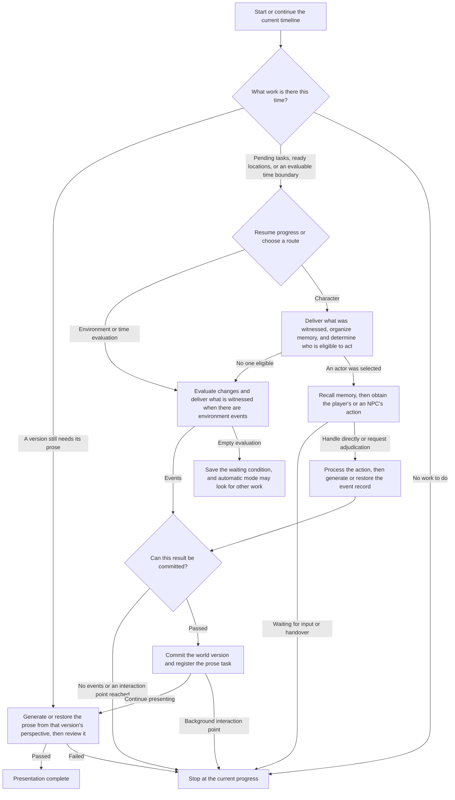

<div align="center">

  
  <h1>JO-ENWSim</h1>

  <h2>Don't choreograph the plot — just let causality play out.<br/>Set a world, drop in an opening, and let it unfold on its own.</h2>

  <p>
    <a href="https://jo-beacon.github.io/JO-ENWSim/">Website</a> ·
    <a href="https://github.com/JO-Beacon/JO-ENWSim">GitHub</a> ·
    <a href="https://github.com/JO-Beacon/JO-ENWSim/releases/latest">Latest release</a>
  </p>

  <p>
    <b>English</b> ·
    <a href="./README.md">简体中文</a> ·
    <a href="README.zh-TW.md">繁體中文</a> ·
    <a href="README.ja.md">日本語</a> ·
    <a href="README.ko.md">한국어</a> ·
    <a href="README.de.md">Deutsch</a> ·
    <a href="README.es.md">Español</a> ·
    <a href="README.fr.md">Français</a> ·
    <a href="README.pt-BR.md">Português</a> ·
    <a href="README.sv.md">Svenska</a>
  </p>

</div>

JO-ENWSim is an emergent narrative world simulator — a causal sandbox run by multiple agents. The player controls one character, and AI drives the rest. There is no script; the world unfolds on its own through causality.

[简体中文](./README.md) · [Apache License 2.0](./LICENSE)


The screenshot above shows the workspace: the left rail lists worlds; the middle is the **sequence canvas** (each column is a location, each step is an event, and lines that cross columns mean "changing location"); the top of the right panel is the always-present **turn-flow diagram** (collapsed to a single line — click it to expand the whole flow), and below it are the details of the current world — setting, opening and characters; memories and models live in the "Edit" dialog at the bottom.

## Current status

**It can really simulate turns now — but it is not yet something you can play.**

What already works:

- Creating worlds, writing the setting and opening, adding characters, configuring model providers (OpenAI / DeepSeek / Xiaomi MiMo / SiliconFlow …)
- **Real turn simulation**: pausing after a single step and resuming are supported; the environment line and the character line each handle events, memory, actions, adjudication and prose, with AI calls executed separately from program validation and writes
- **The action input box.** After the raw text of the player's declared action is sent, the workspace starts or continues the turn. The parser processes that text only when the controlled character is due to act or respond to a contest, separating action, speech and inner thought. The send key defaults to `Ctrl+Enter` and Enter inserts a newline; both can be changed under Settings → Shortcuts.
- Worlds and turns are stored in a local SQLite database and survive a restart
- **Search**: the globe at the far right of the toolbar is the only entry point; clicking it opens a pull-up menu: choose this world's independent search source (No search / Tavily / DeepSeek), or choose "Search once…" to open the search panel and run a manual search; the result is handed to the next environment update. A model's built-in search is a provider capability, enabled in the provider settings, and it is attached only to the environment update. The search ledger is persisted, and the per-turn independent-search limit can be adjusted under Settings → Search Service (default 10, range 1–100); restoring material across restarts is not done yet
- Editing memories manually and rebinding shortcuts
- The right panel can expand the turn flow and show the current phase.
- **The toolbar above the action input**: inserting images, inserting files (text / PDF / images), OCR on images (built-in PP-OCR, Windows / Android) and taking photos (photos only, no video) are all wired; empty text pages in scanned PDFs are rendered automatically and then passed through the built-in OCR. OCR models are not bundled: on first launch the app asks to download them (~21 MB), and they can also be downloaded manually under Settings → Behavior → OCR Models
- **TTS**: system TTS and API TTS are wired (API TTS currently supports OpenAI / Xiaomi MiMo); Melo / Kokoro, like sherpa-onnx models such as AISHELL-3 and LJSpeech, are downloaded on demand under Settings → TTS Service → Models → Downloadable models and are not preinstalled with the installer; Melo / Kokoro can synthesize directly, while the other downloaded models are not yet connected to the synthesis engine. Prose can be read aloud turn by turn, and voices, previews and cache live there too
- **Memory Agent**: organizes each character's memory with encode / reinforce / compress / reinterpret / archive; before acting, it can proactively search, read and select its own recallable archived text, with budget limits and interruption recovery

Not wired yet:

- A persistent ledger, failure log and restart recovery for character search intents

Wherever the interface is not wired up, it says so on the spot instead of pretending otherwise.

## Core principles

- **Information isolation** — every character has its own data. When a character is driven, it sees only what that character knows, never anything else.
- **No special treatment for the player character** — the player character is structurally identical to an NPC; the only difference is that its actions are decided by the player, and the AI must not decide them instead.
- **Don't reduce semantics to numbers** — a character's state, relationships, perception and actions are expressed in text, not compressed into affinity, stat values or probability scores; wherever semantics need judging, the AI decides.

## How it works

A normal character turn first selects one actor. If other characters' attempts contend for the same thing or affect the same outcome, the engine can resolve several attempts in the same turn. Environment turns advance the world's own events.

| Agent | Role |
| --- | --- |
| **God** | Advances the world, selects which characters take part, decides who acts next |
| **Character perception** | What this character perceives right now |
| **Character action** | How this character acts; NPCs are driven by AI, the player character by the player |
| **Character memory** | Organizes this character's memory and, before acting, recalls what it would remember at this moment |

### Timelines and branches

Open the end of any timeline from the 2D branch tree, or fork in place at a branching turn via "View follow-ups". Only committed turns can start a branch. "Replay this turn" opens a new line from the previous completed turn and simulates immediately, so the first turn cannot be replayed.

When you fork, the original line runs according to the "background simulation" setting (Freeze, One Step, One Turn, Until interaction point/Automatic; default One Step). After a restart every line is frozen and resumes only when you continue it manually. While a line waits for player input it starts no new turns, and other turns already running may finish settling before stopping.

Settings → Engine → Automatic turns sets the model concurrency limit, default 1. With the advance mode set to "Until interaction point" and a limit of at least 2, two local turns confirmed not to affect each other can be simulated at the same time; turns involving shared state run one after another.

The "advance mode" in the top bar only governs the turn you start by clicking send: One Step runs a single stage, One Turn runs a whole turn. A world without a player has no interaction point to wait for, so this option shows as "Automatic".

The player can edit stored AI steps. The save keeps the model's original text and the player's revision separately. After the step currently executing finishes, the workspace applies the revision according to the task's checkpoint. Editing a step in a committed turn preserves the original world version and the later turns, and editing prose can also change what is presented. [Revision storage](lib/data/world_timeline.dart#L400)

### Flow of a turn

The diagram below follows the workspace's send button and the "One Step" and "Until interaction point" advance modes, tracing a timeline that has a world version to show where a single operation can go.



Models can be assigned in layers: **the character's own step → the character default → the world step → the world default → the global step → the global default**.

The app's right panel shows run progress with fewer nodes; for example, on-the-spot adjudication and character perception share one highlight position. [Right-panel mapping](lib/ui/turn_flow.dart#L21)

## Build and run

Requires [Flutter](https://flutter.dev) (stable). Building for Windows also needs PowerShell 7 and Inno Setup 6/7; building for Android needs the Android SDK.

```sh
flutter pub get

# run it
flutter run -d windows

# build the Windows release and the split Android APKs
scripts/build.ps1            # add -SkipAndroid to skip Android
```

TTS models are not bundled with the installer; download them at runtime under Settings → TTS Service → Models → Downloadable models.

Artifacts:

- Windows: `build/windows/x64/runner/Release/joenws.exe`
- Installer (Inno Setup) and split-per-ABI Android APKs (arm / arm64 / x64): `dist/`

## License

[Apache License 2.0](./LICENSE) · Copyright 2026 JO-Beacon

Third-party components and their full license texts are in [NOTICE](./NOTICE); you can also read them in the app under **Settings → About → View open-source licenses**.
